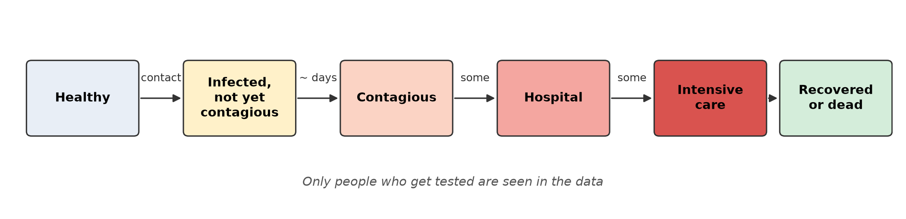
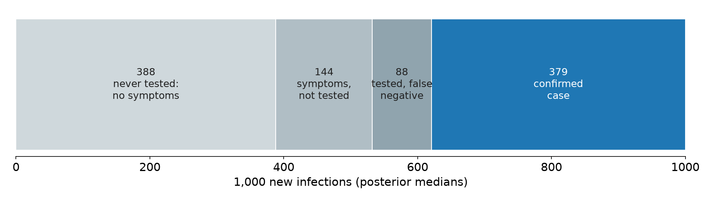
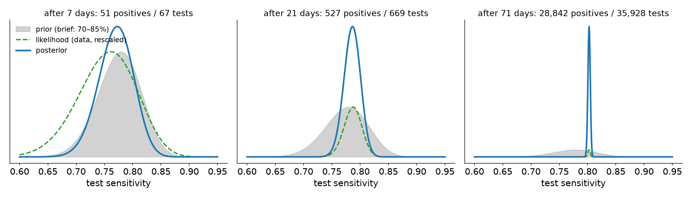
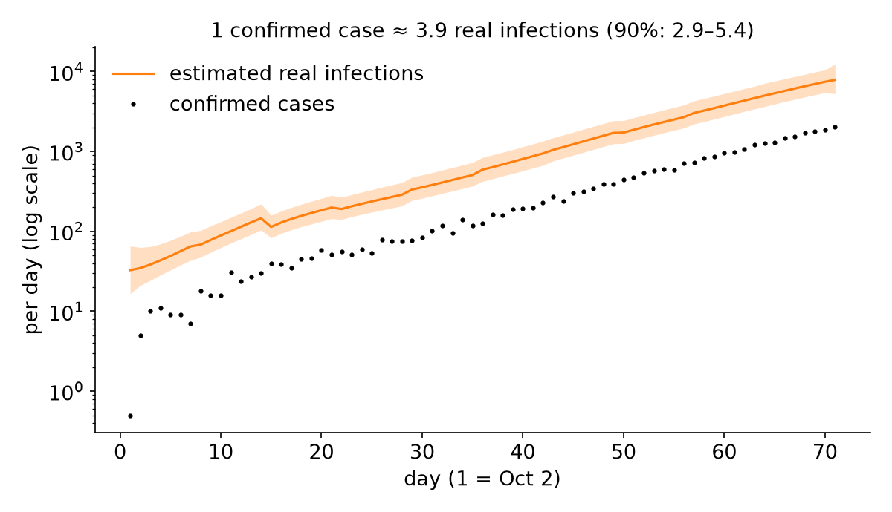
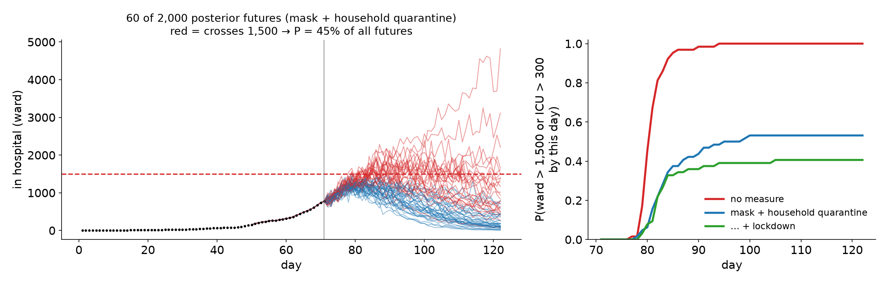
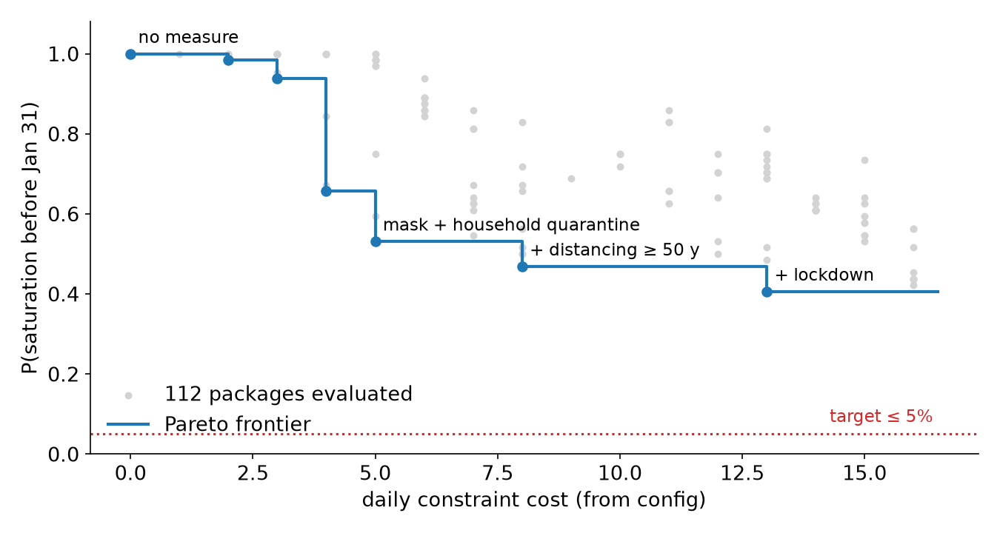
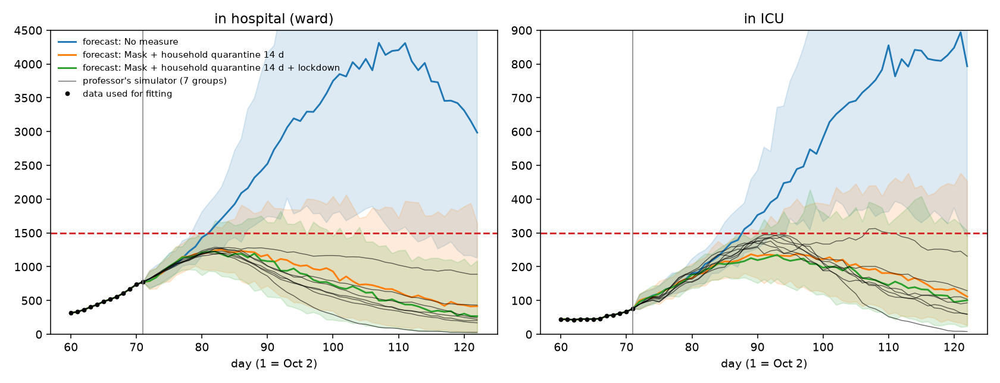

<!-- _class: title -->

# Deciding under uncertainty: steering a simulated epidemic

A data project on forecasting with honest probabilities

Dimitri Marchand

<!--
En une phrase : j'ai construit un outil qui aide à décider quand on ne sait pas tout, en donnant des probabilités plutôt qu'un chiffre unique. Le terrain de jeu est une épidémie simulée, tirée d'un cours de l'Université de Liège.
-->

---

# A city of 1 million, incomplete data, and a decision to make

- Every day: new cases, tests, hospital beds, deaths
- We never see who is actually infected
- Goal: keep hospitals below capacity with the **mildest** possible measures

<!--
Le problème ressemble à beaucoup de problèmes d'entreprise : des données partielles et en retard, une décision à prendre avant de tout savoir, et un coût à chaque mesure. Trop peu de mesures, les hôpitaux saturent. Trop de mesures, on bloque la ville pour rien.
-->

---

# An epidemic is a flow of people from one stage to the next

<!--
Le modèle range chaque habitant dans une case : sain, infecté mais pas encore contagieux, contagieux, hôpital, soins intensifs, guéri ou décédé. Chaque jour, une partie des gens passe à la case suivante, au hasard, selon des probabilités. Ce hasard compte : deux épidémies avec les mêmes règles ne se déroulent jamais exactement pareil.
-->

---

# Tests reveal only part of the epidemic

For 1,000 infections, about **380** show up as confirmed cases.

<!--
On ne teste que les personnes avec des symptômes, et pas toutes. Le test rate environ un malade sur cinq. Résultat : sur 1 000 infections, environ 380 apparaissent dans les chiffres. Tout l'enjeu est de reconstruire l'épidémie cachée à partir de ce qu'on voit.
-->

---

# The Bayesian idea: start from what we know, learn from each day

Grey: expert knowledge. Blue: what we believe after the data.

<!--
L'approche bayésienne est une façon structurée de raisonner comme un bon analyste. On part de ce que disent les experts, avec une marge (en gris). Chaque jour de données affine cette croyance (en bleu). Au début, la connaissance experte pèse beaucoup ; avec plus de données, ce sont les données qui décident. Et on garde toujours une fourchette, jamais un chiffre seul.
-->

---

# One confirmed case hides about 4 real infections

<!--
Première chose que le modèle révèle : pour chaque cas confirmé, il y a en réalité environ 4 infections, avec une fourchette de 3 à 5,5. C'est l'information cachée qu'un simple tableau de bord ne montre pas.
-->

---

# 2,000 possible futures turn into one clear probability

<!--
Au lieu d'une seule prévision, le modèle simule 2 000 futurs plausibles. La probabilité de saturation est simplement la part de ces futurs qui dépassent la capacité de l'hôpital (en rouge). C'est une information directement utilisable par un décideur : « une chance sur deux », c'est plus honnête et plus utile qu'un chiffre unique qui sera faux.
-->

---

# Acting early matters more than acting hard

<!--
J'ai comparé 112 combinaisons de mesures. Sans rien faire, la saturation est certaine. Masque et quarantaine du ménage réduisent le risque à environ une chance sur deux ; ajouter un confinement, beaucoup plus coûteux, ne gagne que dix points. La leçon : à ce stade, l'essentiel des hospitalisations à venir est déjà en route. Il fallait agir plus tôt, et le modèle permet de dire quand.
-->

---

# The forecast held against the real outcome

<!--
Test le plus important : après le cours, les vraies suites du simulateur ont été publiées. Le pic réel d'hospitalisations (environ 1 200 à 1 300) tombe exactement dans ma prévision (médiane 1 255), alors que mon modèle n'avait jamais vu ces données.
-->

---

# What this project shows about how I work

- **Model what you can't see**, and say how sure you are
- **Check before trusting**: I caught and fixed a failed computation
- **Turn analysis into a decision**: probabilities, costs, trade-offs

Python · NumPyro · JAX · ArviZ · Streamlit · reproducible pipeline with tests and CI

<!--
Trois choses transférables à n'importe quel poste data : modéliser ce qu'on ne voit pas directement en quantifiant l'incertitude ; vérifier ses résultats avant de les présenter (mon premier calcul avait échoué et je l'ai détecté) ; et transformer une analyse en aide à la décision concrète.
-->
