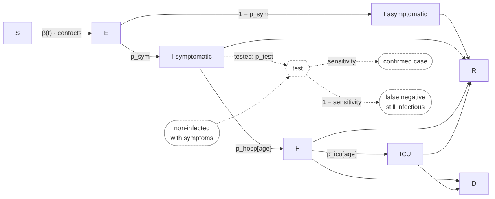
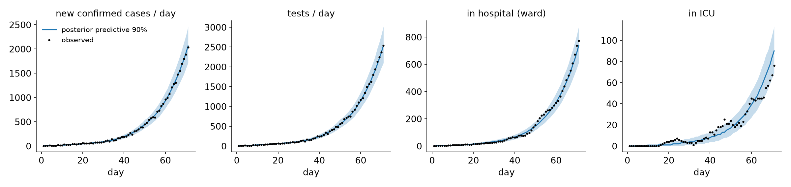
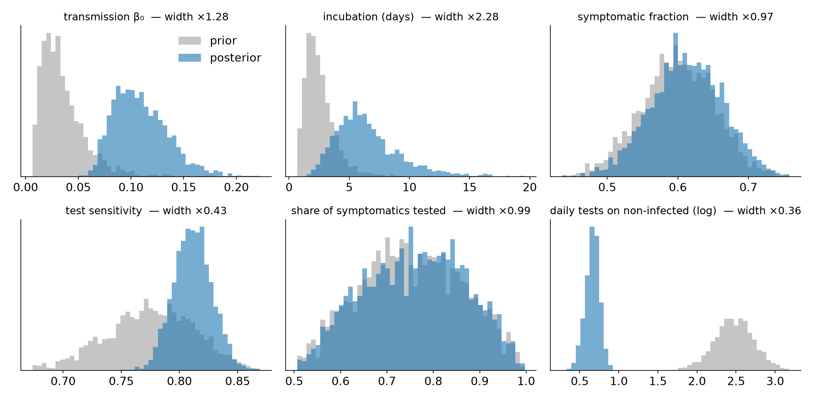
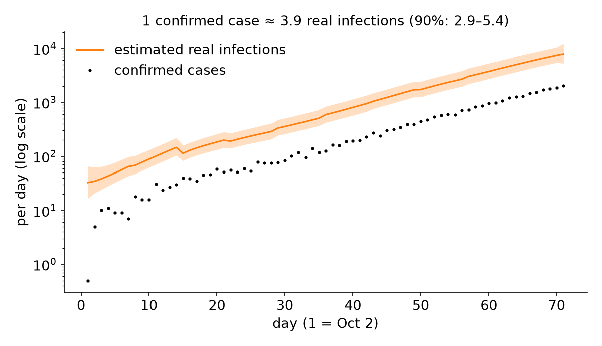
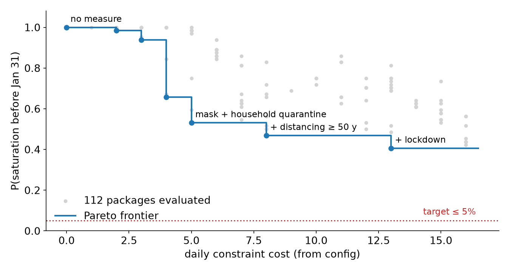
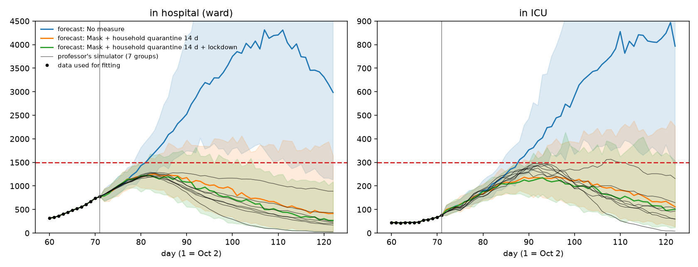

<!-- _class: title -->

# Steering a simulated epidemic with Bayesian forecasts

PROJ0016 data (ULiège, 2020) · age-structured SEIRH · NumPyro / NUTS

Dimitri Marchand

<!--
Le projet part d'un exercice réel du cours de G. Louppe : une ville simulée d'un million d'habitants, des données publiées chaque jour, et une décision de santé publique à prendre. Je l'ai refait entièrement avec une approche bayésienne. Le fil rouge : comment passer de données partielles à une probabilité de saturation des hôpitaux.
-->

---

# The analyst sees only tests, not infections, and must decide on day 71

- 71 days of public data: confirmed cases, tests, ward, ICU, deaths
- Goal: keep ward < 1,500 and ICU < 300 until Jan 31, with the **least constraining** measures
- Day 71: 774 in ward, 76 in ICU, cases doubling every **9.6 days** (8.6–10.8)

<!--
Trois difficultés : on ne voit que les personnes testées, le test rate environ une infection sur cinq, et la décision doit être prise avant que l'effet ne soit visible, car il y a environ deux semaines entre infection et hospitalisation.
-->

---

# The model separates infection, testing and test result

<!--
Dynamique : SEIRH à deux groupes d'âge (moins et plus de 60 ans), β(t) en marche aléatoire hebdomadaire. Couche d'observation explicite en pointillés : une part des symptomatiques est testée, le test détecte avec une sensibilité < 1, et des non-infectés sont aussi testés. Vraisemblances binomiales négatives sur cas, tests, hôpital, soins intensifs, décès. Le modèle est volontairement plus simple que le simulateur.
-->

---

# Priors come from the course brief; the rest is labelled as an assumption

| Parameter | Prior | Source |
|---|---|---|
| Incubation | LogNormal, 90% in 1–5 days | brief |
| Symptomatic fraction | Beta, 50–70% | brief |
| Test sensitivity | Beta, 70–85% | brief |
| Share of symptomatics tested | 0.5 + 0.5·Beta(2,2) | brief (≥ 50%) |
| Hospitalisation risk by age | hierarchical logit-normal, positive age slope | assumption |
| Tests on non-infected / day | LogNormal, median 300 | assumption |

<!--
Règle : une proportion reçoit une Beta, une durée une log-normale, calées pour que l'intervalle des consignes soit l'intervalle central. Tout ce qui ne vient pas des consignes est marqué hypothèse. La dernière ligne va poser problème : retenez-la.
-->

---

# First NUTS run failed: R̂ up to 15, two chains frozen at their start

R̂ 15 → 1.016

- Cause: default random initialisation landed where the step size collapsed
- Fix: `init_to_median`, 1,000 warm-up steps, target accept 0.9
- Final: 4 chains × 500 draws, **0 divergences**, min ESS 387

<!--
Point important pour un cours bayésien : je ne cache pas l'échec. Le premier ajustement donnait des R̂ de 4 à 15 et des ESS de 4. En regardant chaîne par chaîne, deux chaînes n'avaient jamais bougé (écart-type nul) : ce n'était pas de la multimodalité mais un problème d'initialisation. Les deux chaînes valides étaient d'accord entre elles. Après correction, R̂ max 1,016, juste au-dessus du seuil strict de 1,01 que je m'étais fixé, ESS minimum 387 pour un seuil de 400 : je le signale tel quel.
-->

---

# The posterior predictive reproduces all four observed series

<!--
Bandes à 90 % de la loi prédictive a posteriori, bruit d'observation compris. Les cas, les tests et l'hôpital sont bien reproduits. Les soins intensifs sont un peu surestimés en fin de période : c'est la série la plus bruitée et la plus petite.
-->

---

# The data pinned sensitivity, overturned one prior, and left two to the prior

<!--
Lecture : le rapport de largeur posterior / prior. La sensibilité est apprise (×0,43) : la positivité vaut 80 %, quasi constante, donc presque tous les tests portent sur des infectés et la positivité ≈ la sensibilité. Le fond de tests sur non-infectés : conflit prior-données, le prior (300 par jour, mon hypothèse) était faux, le posterior vaut environ 5. Le taux de dépistage et la fraction symptomatique ne sont pas appris (×0,97, ×0,99) : les données ne permettent pas de les séparer. L'incubation : le posterior (6,5 jours) sort de l'intervalle des consignes, c'est un signal de mauvaise spécification (pas de stade présymptomatique dans mon modèle).
-->

---

# One confirmed case stands for about 4 real infections

<!--
C'est la quantité cachée que l'approche bayésienne permet d'estimer avec son incertitude : 3,9 infections réelles par cas confirmé en fin de période (intervalle 2,9 à 5,4). Attention : elle hérite de l'incertitude sur le taux de dépistage, qui n'est pas identifié.
-->

---

# No package of measures brings P(saturation) below 5% from day 71

<!--
112 combinaisons évaluées sur 2 000 trajectoires a posteriori, avec un délai de 3 jours et 90 % de respect. Sans mesure : saturation certaine, pic médian près de 5 000 hospitalisés. Le meilleur rapport coût / risque est masque + quarantaine du ménage 14 jours : 53 %. Ajouter le confinement ne descend qu'à 41 %. Raison : l'inertie. Les hospitalisations des deux semaines suivantes viennent d'infections déjà en cours. Conclusion bayésienne : à J71 il est trop tard pour garantir le seuil ; la décision aurait dû être prise plus tôt, et le modèle permet de dire quand.
-->

---

# Out of sample, the professor's simulator peaked where we forecast

<!--
Validation externe : après le cours, l'assistant a publié les trajectoires réelles du simulateur à agents sous les mesures de 7 groupes. Pic réel : 1 198 à 1 286 hospitalisés autour du jour 82, 275 à 313 en soins intensifs. Notre prévision avec mesures fortes : pic médian 1 255 (intervalle 1 013 à 2 066). Les 7 trajectoires restent dans nos bandes, alors que notre modèle est beaucoup plus simple que le simulateur à agents. Le groupe Virus_buster dépasse 300 en soins intensifs : la saturation n'était pas improbable.
-->

---

# What I would change next

- **Mis-specification**: add a presymptomatic stage; incubation is pushed outside the brief
- **Identifiability**: testing rate × symptomatic fraction need extra information (e.g. serology)
- **Calibration**: rolling-origin backtest of the model itself; so far only baselines are scored

<!--
Trois limites concrètes. Un : le posterior de l'incubation sort des consignes, signe qu'il manque une structure. Deux : certaines paires de paramètres restent confondues. Trois : le backtesting complet du modèle (réajuster à chaque semaine et scorer les prévisions) n'est pas encore fait, seules les références naïves le sont.
-->

---

# Takeaways

- The Bayesian workflow caught a sampling failure **and** a wrong prior
- A probability of saturation, not a point forecast, is what a decision needs
- The forecasts held against the real simulator's outcome

Code: NumPyro · JAX · ArviZ · 4 chains NUTS · 71 days · 2 age groups

<!--
Si vous ne retenez qu'une chose : le workflow bayésien (prior predictive, diagnostics, posterior predictive, validation) m'a permis de détecter deux erreurs que j'aurais manquées avec un ajustement par moindres carrés, et de donner au décideur une probabilité plutôt qu'un chiffre.
-->
