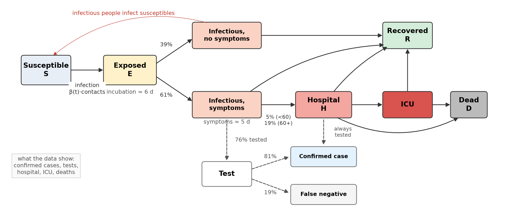
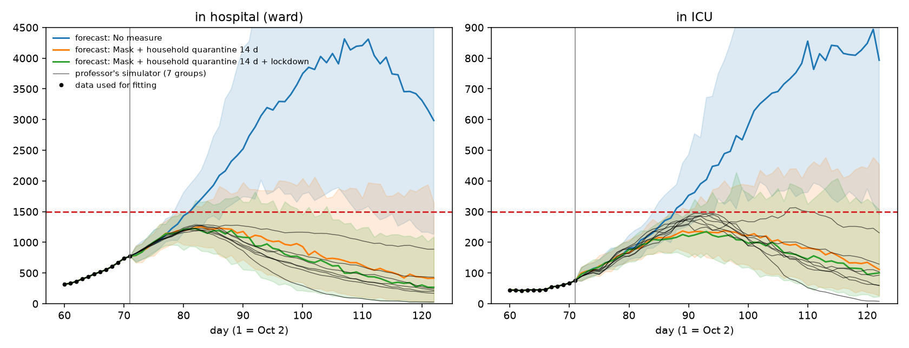

<!-- _class: title -->

# Steering a simulated epidemic with Bayesian forecasts

PROJ0016 · ULiège 2020 · 71 public days · NumPyro NUTS

<span class="small">Dimitri Marchand · https://github.com/dimiphoton/bigdataSIR</span>

<!--
Le fil est une décision, pas une méthode. Une ville d'un million d'habitants, des comptages publiés, et un seuil d'hôpitaux à ne pas dépasser. Tout le reste sert à construire la probabilité de ce seuil.
-->

---

# A classical fit and a Bayesian inference name the same moves

| Classical habit | Bayesian equivalent | In this project |
|---|---|---|
| Fit | Inference | NUTS on 71 days, not a point $\hat\theta$ |
| Loss | Likelihood | Negative binomial on cases, tests, ward, ICU |
| L2 penalty | Gaussian prior | Log incubation, log $\beta$ |
| Best $\hat\theta$ | Posterior | 2,000 draws, not the median alone |
| Confidence interval | Credible interval | Incubation 2.4–10.4 days |
| Optimiser converged | $\hat R$, ESS | $\hat R$ up to 1.02, ESS down to 387 |
| Prediction | Posterior predictive | Fan of future ward counts |
| Hyperparameter search | Hierarchical prior | Severity by age, older group higher |
| Decision threshold | Probability of an event | Keep a measure only if P(saturation) ≤ 5% |

<!--
Lire le tableau de haut en bas, une ligne. L'idée à laisser : on ne rend pas une meilleure valeur, on rend toutes les valeurs encore compatibles avec les consignes et avec les 71 jours.
-->

---

# The data come from an external simulator whose parameters are fixed, then hidden

| | Simulator (the city) | Inference model (what is fitted) |
|---|---|---|
| Who generates the rows | Course simulator, parameters drawn once | It never reads `.truth.json` |
| What is published | Cases, tests, ward, ICU, deaths | Those five columns only |
| Structure | 5 age groups, presymptomatic stage, daily binomial draws | 2 age groups, no presymptomatic stage, expectation step |
| What stays secret | $\beta$, durations, severity, testing rate | These are the unknowns |

<span class="small">Day 71 in `data/external/data.csv`: 2,035 confirmed, 2,539 tests, 774 in ward, 76 in ICU.</span>

<!--
Insister sur la séparation. Le simulateur a déjà tiré ses paramètres. L'ajustement n'a pas le droit de les regarder. Le modèle qu'on ajuste est plus petit que la ville : deux âges, pas de présymptomatique.
-->

---

# On day 71 the analyst sees tests, and has to choose


- Published that day: **774** in ward, **76** in ICU
- Cases are doubling every **9.6 days** (8.6–10.8)
- The limits to hold until 31 January: ward **< 1,500**, ICU **< 300**

<!--
Trois faits, pas une méthode. On ne voit pas les infectés. Le doublement est encore rapide. Les deux plafonds sont ceux des consignes, pas des miens.
-->

---

# The work is five steps: prior, likelihood, posterior, forecast, decision

1. **Prior** — intervals from the brief, or a labelled assumption
2. **Likelihood** — negative binomial on the published series
3. **Posterior** — NUTS, 4 chains, draws kept only if the chains agree
4. **Forecast** — each draw is simulated forward with process noise
5. **Decision** — cheapest measure whose P(saturation) is ≤ 5%

<!--
C'est le plan du reste de l'exposé. Ne pas développer. Dire que les étapes 4 et 5 sont le produit ; les étapes 1 à 3 servent à ne pas leur donner un chiffre trop sûr.
-->

---

# Each person sits in one box; each day, some move to the next



<span class="small">Posterior medians on the arrows: incubation 6.5 days, 61% symptomatic, hospital risk 5% under 60 and 20% over 60.</span>

<!--
Montrer le schéma une fois. La boucle en pointillé est la transmission. La couche du bas est le test : elle ne change pas qui est infecté, elle change ce qu'on publie. Les pourcentages sont des médianes a posteriori, pas les paramètres cachés.
-->

---

# One day is three equations: infection, exit, and what gets published

$$\lambda_g(t)=\beta(t)\sum_j C_{gj}\,(\kappa I_{a,j}+I_{s,j})/N_j$$

$$n_{\mathrm{new}}=S\,(1-e^{-\lambda})\qquad P(\mathrm{leave})=1-e^{-1/d}$$

$$\mathbb{E}[Y^{+}]=\mathrm{sens}\cdot p_{\mathrm{test}}\cdot C_{\mathrm{sym}}+A$$

$A$ = admissions not already confirmed. Specificity is fixed at 100%.

$$\text{ward entry}=(\text{symptomatic exits})\times p_{\mathrm{hosp}}\qquad \text{ICU entry}=(\text{ward exits})\times p_{\mathrm{icu}}$$

<!--
Lire les trois blocs dans l'ordre. D'abord qui s'infecte, ensuite qui quitte sa case, ensuite ce qui est écrit dans le fichier. Le dernier bloc est le seul lien entre les infectieux et les lits.
-->

---

# Of 1,000 infections, about 380 become confirmed cases


<span class="small">Posterior medians: 388 never symptomatic, 144 symptomatic but untested, 88 false negatives, 379 confirmed.</span>

<!--
Le test ne regarde que les symptomatiques, et pas tous. Avec les médianes, 379 des 1 000 infections du jour sont confirmées. Ce n'est pas encore le rapport 3,9 de la fin : un cas publié aujourd'hui a été infecté plus tôt, pendant une phase qui double encore.
-->

---

# $\beta$ is the transmission rate; $R_0$ is the offspring count while everyone is susceptible

$$\lambda = \beta \times (\text{infectious pressure}) \qquad R_0 = \beta \times d_I \qquad R_e(t) = R_0 \times S(t)/N$$

| | In the one-group step on the next slide |
|---|---|
| $\beta$ | **0.41 / day**, set so cases double every 9.6 days |
| Infectious spell $d_I$ | **4.9 days**, posterior median |
| $R_0$ | **1.99**. One case replaces itself about twice at the start |
| Threshold | new infections stop growing when $S = N/R_0$, here **50%** |

<span class="small">Fitted $\beta_0$ is 0.11 (0.07–0.15). It multiplies the contact matrix, so it is not 0.41.</span>

<!--
β est le débit de contamination. R0 est le nombre de personnes infectées par un cas tant que tout le monde est encore susceptible. Re est le même nombre une fois qu'une partie de la ville est déjà immunisée : on le multiplie par la part encore susceptible. Au-dessus de 1, ça croît. En dessous, les nouveaux infectés baissent. Le 0,41 de cette diapositive n'est pas le β0 ajusté : celui-là vaut 0,11 parce qu'il est ensuite multiplié par les contacts.
-->

---

# New infections fall only after the susceptible stock thins, and the epidemic stops on its own


Day 71: $S=95\%$, so $R_e \approx 1.89$. Peak day **107**. This step infects **84%**. No measure.

<!--
Le message pour la décision : au jour 71 l'épuisement des susceptibles n'a pas commencé, Re vaut encore environ 1,9. L'épidémie s'arrête seule plus tard, autour du jour 107, après avoir touché 84 % de la ville dans ce pas simplifié. La formule classique de taille finale, pour un R0 de 1,99, donne plutôt 79 %. Attendre cet arrêt, c'est laisser passer le pic d'hôpitaux.
-->

---

# A lower $\beta$ flattens the peak; from day 71 the same cut comes late


| | Peak of new infections from day 1 | Same factor from day 71 |
|---|---|---|
| No measure, $R_0=1.99$ | 16,200 on day 107 | same |
| Mask $\times 0.82$, $R_0=1.63$ | 9,900 on day 144 | 10,300 on day 115 |
| Lockdown $\times 0.52$, $R_0=1.03$ | the wave does not take off | already 3,300, then it falls |

<span class="small">One-group new infections, not ward beds. The factors are those of the 112 packages.</span>

<!--
À gauche, baisser β dès le jour 1 décale et rabaisse le pic : c'est aplatir la courbe. Le masque du projet multiplie β par 0,82. Le confinement le multiplie par 0,52, et R0 tombe à 1,03 : la vague ne démarre pas. À droite, la même baisse au jour 71 arrive quand la croissance est déjà lancée. Ce graphe compte des infections, pas des lits. Le décalage vers l'hôpital reste celui du modèle complet.
-->

---

# Priors come from the brief; anything else is marked as an assumption

| Parameter | Prior | Where it comes from |
|---|---|---|
| Incubation | Log-normal, central 90% = 1–5 days | Brief |
| Symptomatic spell before hospital | Log-normal, central 90% = 4–10 days | Brief |
| Symptomatic fraction | Beta, mean 0.60, range 0.50–0.70 | Brief |
| Test sensitivity | Beta, mean 0.78, range 0.70–0.85 | Brief |
| Share of symptomatics tested | $0.50 + 0.50\cdot\mathrm{Beta}(2,2)$ | Brief, floor at 50% |
| Hospital spell / ICU spell | Log-normal, medians 8 d and 10 d | Assumption |
| Severity by age | Logit-normal, older group higher | Assumption |
| Tests on people who are not infected | Log-normal, median **300 / day** | Assumption |

<!--
La dernière ligne est une hypothèse à moi, pas une consigne. Elle va être contredite. Les durées d'hôpital et la gravité par âge non plus ne sont pas dans les consignes : le posterior ne pourra pas les « retrouver » s'il n'a pas de quoi les séparer.
-->

---

# The update is visible on one parameter: the prior tightens as days are added


$$p(\theta \mid \mathrm{data}) \propto p(\mathrm{data} \mid \theta)\, p(\theta)$$

<span class="small">Toy update of sensitivity from positivity alone. The full model, which also allows tests on uninfected people, gives 0.81 (0.79–0.84).</span>

<!--
Le graphe est un seul paramètre, pour voir le produit prior fois vraisemblance. Après 7 jours le prior pèse encore. Après 71 jours le jouet est presque une pointe. Dans le modèle complet l'intervalle reste 0,79–0,84, parce que d'autres paramètres peuvent expliquer les mêmes positifs.
-->

---

# A forecast carries three uncertainties, and all three are kept

| Source | What is unknown | How it enters |
|---|---|---|
| Parameters | $\beta$, durations, risks | Width of the posterior; shrinks with data |
| Process | Who gets infected today is a draw | $1-e^{-1/d}$ each day, and a weekly step on $\beta(t)$ |
| Observation | Tests miss people | Testing layer, then a negative binomial |

$$p(\mathrm{future}\mid\mathrm{data})=\int p(\mathrm{future}\mid\theta)\,p(\theta\mid\mathrm{data})\,d\theta$$

About 2,000 posterior draws, each simulated with noise.

<!--
Si on ne garde que la médiane des paramètres, on oublie les deux dernières lignes et on sous-estime le risque. La probabilité de saturation plus loin est exactement cette intégrale, comptée comme une part de courbes.
-->

---

# Inference is four NUTS chains started from the prior median

```python
kernel = NUTS(
    seirh_model,
    target_accept_prob=nuts.target_accept,
    init_strategy=init_to_median(num_samples=100),
)
mcmc = MCMC(
    kernel,
    num_warmup=nuts.num_warmup,
    num_samples=nuts.num_samples,
    num_chains=nuts.num_chains,
)
mcmc.run(key, **kwargs)
```

<span class="small">`src/epidemic/inference/fit.py`. Kept run: 4 chains, 1,000 warmup steps, 500 draws each, target accept 0.9.</span>

<!--
Montrer que le code ne cherche pas un minimum. Il lance quatre marches qui doivent se retrouver. init_to_median est là parce qu'un départ au hasard coinçait les chaînes. Les réglages du run conservé sont sous le code, pas dans les valeurs par défaut du YAML.
-->

---

# Four chains count only when they move through the same region


| | First attempt | Kept run |
|---|---|---|
| What the traces do | Flat, stuck apart | Overlapping, still moving |
| $\hat R$ | up to 15 | **1.02** (hospital spell) |
| ESS | 4 | **387** (hospital spell) |
| Divergences | — | **0** |

<span class="small">Own gates were $\hat R < 1.01$ and ESS ≥ 400. This run misses both, on the hospital duration.</span>

<!--
À gauche, une chaîne plate n'explore pas : ce n'était pas deux modes, c'était un pas trop petit après un mauvais départ. À droite, les chaînes se recouvrent. On s'arrête quand même avant de croire l'intervalle de la durée d'hôpital : R-hat 1,02 et ESS 387, sous les seuils que je m'étais fixés.
-->

---

# An inferred parameter is a density, drawn against its prior


<span class="small">Gray = prior, blue = posterior. The label is (posterior width) / (prior width). Under 0.50, the data pinned it.</span>

Only sensitivity (×0.43) and tests on uninfected people (×0.36) pass that bar.

<!--
Apprendre à lire un panneau avant les conclusions. Si le bleu recouvre le gris, les données n'ont rien ajouté. Si le bleu est ailleurs et plus étroit, elles ont appris. Ici, deux panneaux seulement sont vraiment resserrés.
-->

---

# The posterior predictive covers the four published series


<span class="small">Bands are the 90% posterior predictive, observation noise included. Deaths are in the likelihood and are not on this figure.</span>

Cases, tests and ward sit in the band. ICU is a bit high at the end: it is the smallest series.

<!--
Ceci vérifie la vraisemblance, pas les paramètres. Un modèle peut reproduire l'hôpital avec de mauvaises durées, si le risque d'hospitalisation compense. C'est le sujet des diapositives suivantes.
-->

---

# The data pinned sensitivity, rejected the flu prior, and left two parameters alone

| Parameter | Posterior median (90%) | Width ratio | Reading |
|---|---|---|---|
| Sensitivity | **0.81** (0.79–0.84) | ×0.43 | Pinned. Positivity stays near 80% |
| Tests on uninfected / day | **4.7** (3.1–6.3) | ×0.36 | Prior median was 300. Rejected |
| $\beta_0$ | 0.11 (0.07–0.15) | ×1.28 | Moved, not tightened |
| Symptomatic fraction | 0.61 (0.54–0.70) | ×0.97 | Still the prior |
| Share tested | 0.76 (0.58–0.93) | ×0.99 | Still the prior |

<!--
Deux résultats nets. La sensibilité est apprise. Le fond de 300 tests par jour sur des non-infectés était mon hypothèse, et elle est fausse : le posterior est à 5 par jour. Les deux dernières lignes n'ont pas bougé : on y revient.
-->

---

# Incubation is pushed to 6.5 days, outside the 1–5 day brief

| | Days |
|---|---|
| Brief, central 90% of the prior | 1–5 |
| Posterior median | **6.5** |
| Posterior 90% interval | 2.4–10.4 |
| Width vs the prior | ×2.28, wider, not tighter |

The inference model has no presymptomatic box. The simulator gives that stage 1–3 days. The 6.5 days absorb a delay the model does not have.

<!--
Ne pas présenter 6,5 comme une incubation retrouvée. L'intervalle est plus large que le prior et sort des consignes. C'est le signe qu'il manque une case, pas une découverte sur le virus.
-->

---

# Only the flow into hospital moved; stays and deaths stayed on the prior

| Passage | Posterior median (90%) | Prior it is judged against |
|---|---|---|
| Symptomatic spell, $I \to$ out | 4.9 d (2.8–6.7) | Brief 4–10 d |
| $I \to$ ward, under 60 / 60+ | **4.7%** (2.0–7.4) / **20%** (6–36) | Centred near 2%, older higher |
| Ward spell | 7.0 d (3.4–10.5) | Median 8 d. ESS 387, $\hat R$ 1.02 |
| Ward $\to$ ICU | 10% (3–18) / 32% (14–54) | Centred near 15% |
| ICU spell | 9.3 d (4.5–13.2) | Median 10 d |
| Death in ward | 0.9% (0.1–1.8) / 3.7% (0.1–7.5) | Centred near 2% |
| Death in ICU | 13% (1–24) / 34% (8–60) | Centred near 25% |

<!--
La seule ligne qui s'écarte clairement est le risque d'hospitalisation, surtout après 60 ans, et son intervalle reste large. Les durées de séjour et les décès recouvrent encore leur prior. On ne les cite pas comme des paramètres retrouvés.
-->

---

# Testing rate and symptomatic fraction stay interchangeable

$$\mathbb{E}[Y^{+}] \propto p_{\mathrm{test}}\times(\text{symptomatic fraction})\times(\text{new infections})$$

| | Posterior 90% | Width ratio |
|---|---|---|
| Share of symptomatics tested | 0.58–0.93 | ×0.99 |
| Symptomatic fraction | 0.54–0.70 | ×0.97 |

Several pairs print the same confirmed cases. The ward series does not separate them either, once $p_{\mathrm{hosp}}$ can move.

<!--
Montrer le produit. Si je double le taux de test et que je baisse la fraction symptomatique, les positifs ne changent pas. C'est pour ça que ces deux lois sont restées sur le prior. Il faudrait une autre mesure, par exemple une sérologie, pour les séparer.
-->

---

# One confirmed case stands for about 4 real infections


<span class="big">3.9</span> &nbsp; infections per confirmed case at the end of the 71 days

<span class="small">90% interval 2.9–5.4. The width is the unidentified testing rate from the previous slide.</span>

<!--
C'est la quantité utile que le modèle sort quand même : l'épidémie cachée, avec un intervalle. Ne pas la présenter comme précise. Elle bouge dès que le taux de dépistage bouge, et ce taux n'est pas identifié.
-->

---

# A probability is the share of plausible futures that cross the line


$$P(\mathrm{sat})=\frac{1}{M}\sum_{m=1}^{M}\mathbf{1}\{\mathrm{ward}_m>1500\ \mathrm{or}\ \mathrm{ICU}_m>300\}$$

<span class="small">$M = 2000$ posterior trajectories. Red curves cross 1,500 ward beds.</span>

<!--
Lire la formule comme un comptage. Pas de seuil magique sur une courbe moyenne : on compte les courbes qui dépassent. Le graphe montre lesquelles, et quand. L'inertie met presque tout le franchissement entre les jours 78 et 90.
-->

---

# The alert score is P(saturation); a measure is kept only if it falls to 5% or below

$$a^{\star}=\arg\min_a \mathrm{cost}(a)\quad\text{subject to}\quad P(\mathrm{sat}\mid a)\le 0.05$$

| Action from day 71 | Cost | P(saturation) | Median peak ward |
|---|---|---|---|
| None | 0 | **1.00** | 4,934 |
| Mask + 14-day household quarantine | 5 | **0.53** | 1,442 |
| That package + lockdown | 13 | **0.41** | 1,419 |

No row is ≤ 0.05. The alert stays on. The cheapest package that was scored still leaves a 53% chance of crossing a limit.

<!--
La règle est posée avant de voir le tableau : on ne retient une mesure que si la probabilité passe sous 5 %, et parmi celles-là on prend la moins coûteuse. Ici l'ensemble est vide. Le meilleur rapport du tableau est 53 %, pas 5 %.
-->

---

# From day 71, no package brings that score under 5%


112 packages, scored on the same 2,000 trajectories. Delay 3 days, compliance 90%.

The lowest score is **41%** (mask, 14-day household quarantine, and lockdown). Adding distancing does not go lower.

<!--
Le graphe est le même calcul que le tableau, pour les 112 paquets. Montrer que le nuage ne touche pas 5 %. La raison est l'inertie : les lits des deux prochaines semaines sont déjà des infections en cours au jour 71.
-->

---

# Out of sample, the professor's simulator peaked where the forecast placed it



| | Ward peak | ICU |
|---|---|---|
| Seven published trajectories, strong measures | 1,198–1,286, around day 82 | 275–313 |
| This model's forecast under strong measures | median **1,255** (1,013–2,066) | the upper trajectories cross 300 |

The seven curves stay inside the band. One of them, Virus_buster, does cross 300 ICU beds.

<!--
Ceci compare des trajectoires d'hôpitaux, pas des paramètres. Le simulateur du cours est plus détaillé que le modèle. Le pic médian tombe au milieu des sept courbes publiées. L'intervalle, lui, va de 1 000 à 2 000 : la prévision contenait le pic, elle ne l'a pas serré.
-->

---

# This model was not backtested, and this fit misses its own gates

| Gap | What is on file | What is missing |
|---|---|---|
| Chains | $\hat R$ 1.02, ESS 387, 0 divergences | Gates were 1.01 and 400 |
| Forecast score | Naive baselines cover **31%** of outcomes with a 90% band | The model's own rolling-origin score |
| Parameters | Posterior margins in `defense/summary_key.csv` | A recovery check against known parameters |

<!--
Trois manques, sans les habiller. Les chaînes sont utilisables pour l'hôpital et pas assez propres pour la durée de séjour. Les 31 % sont les références naïves, pas ce modèle. Personne n'a revérifié les paramètres sur une ville dont on connaît les vrais chiffres.
-->

---

# What I would change next

- **Add the presymptomatic stage.** Incubation at 6.5 days is that missing box, not a duration.
- **Separate testing rate from the symptomatic fraction.** Needs a series this file does not have.
- **Score the model the way the baselines were scored.** Refit at each week, then CRPS at 7, 14 and 21 days.

<!--
Chaque puce est le défaut de la diapositive correspondante : incubation, confusion dépistage-symptômes, absence de backtest. Ne pas en ajouter une quatrième.
-->

---

# The chains caught a bad start, the prior caught a false flu rate, and the ward forecast held

- First NUTS run: $\hat R$ up to 15. The kept run overlaps, with ESS 387.
- The prior of 300 tests a day on uninfected people fell to **4.7**.
- Under strong measures the published peaks, 1,198–1,286, sit on the forecast median **1,255**.

<span class="small">NumPyro · JAX · ArviZ · 4 chains · 71 days · 2 age groups</span>

<!--
Fermer sur les trois faits qu'un ajustement par moindres carrés n'aurait pas rendus de la même façon : un départ de chaîne cassé, un prior chiffré qui était faux, et une probabilité de saturation plutôt qu'un pic unique. Le pic d'hôpitaux, lui, est tombé au bon endroit, dans un intervalle large.
-->
