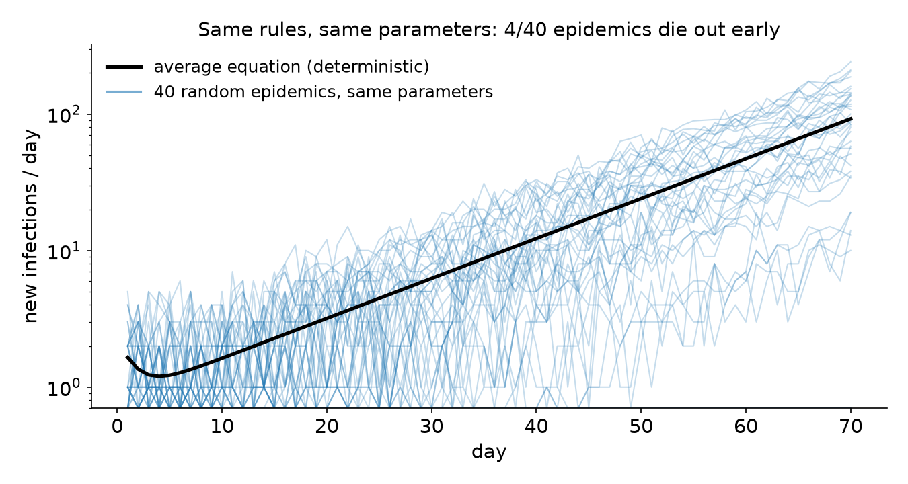
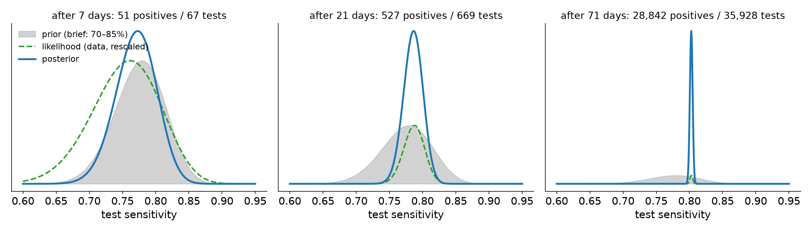
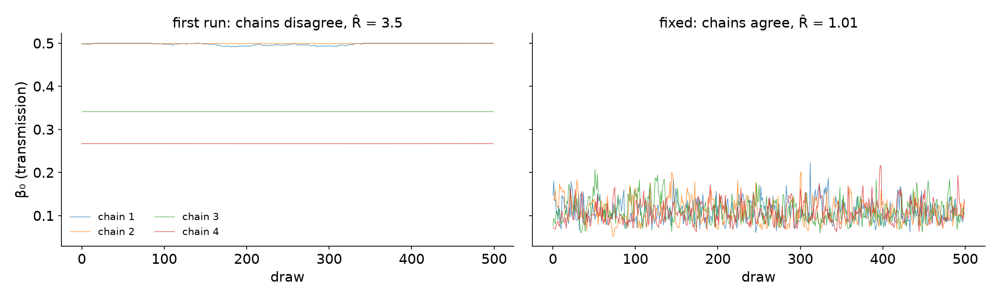
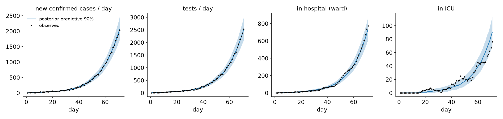

<!-- _class: title -->

# Steering a simulated epidemic with Bayesian forecasts

PROJ0016 data (ULiège, 2020) · age-structured SEIRH · NumPyro / NUTS

Dimitri Marchand

<!--
Le projet part d'un exercice réel du cours de G. Louppe : une ville simulée d'un million d'habitants, des données publiées chaque jour, et une décision de santé publique à prendre. Je l'ai refait entièrement avec une approche bayésienne. Le fil rouge : comment passer de données partielles à une probabilité de saturation des hôpitaux.
-->

---
# The analyst sees only tests, not infections, and must decide on day 71

- 71 days of public data: confirmed cases, tests, ward, ICU, deaths
- Goal: keep ward < 1,500 and ICU < 300 until Jan 31, with the **least constraining** measures
- Day 71: 774 in ward, 76 in ICU, cases doubling every **9.6 days** (8.6–10.8)

<!--
Trois difficultés : on ne voit que les personnes testées, le test rate environ une infection sur cinq, et la décision doit être prise avant que l'effet ne soit visible, car il y a environ deux semaines entre infection et hospitalisation.
-->

---
<!-- _class: part -->

# Part 1 — How the epidemic is modelled

---
# Every person sits in one box; each day, some move to the next

<!--
Schéma du modèle d'inférence, avec les valeurs a posteriori (médianes). Une personne saine est infectée par contact avec des contagieux (flèche rouge en pointillé : c'est la boucle qui crée la croissance exponentielle). Après une incubation d'environ 6 jours, 61 % développent des symptômes, 39 % non. Parmi les symptomatiques, 5 % des moins de 60 ans et 19 % des plus de 60 ans vont à l'hôpital, une partie passe en soins intensifs, d'autres décèdent. En bas, en pointillé : la couche de test, qui ne modifie pas l'épidémie mais détermine ce que l'on voit. Deux groupes d'âge, avec une matrice de contact tirée des statistiques du cours.
-->

---
# Moving between boxes is a daily coin flip, not a fixed flow

**Leaving a stage** of mean length *d* days:

P(leave today) = 1 − e−1/d nleaving ~ Binomial(n, P)

**Getting infected**, for a susceptible in age group *g*:

λg(t) = β(t) Σj Cgj (κ Ia,j + Is,j) / Nj nnew ~ Binomial(Sg, 1 − e−λg)

**Branching** (symptoms, hospital, ICU, death): Binomial splits with age-specific probabilities.

<!--
Ce sont les règles du simulateur « réalité » (chaîne binomiale, pas d'un jour). Chaque personne a chaque jour une probabilité de changer de case : pour une durée moyenne d, c'est 1 − exp(−1/d), ce qui donne des durées géométriques. Le graphe montre 40 épidémies avec exactement les mêmes paramètres : certaines s'éteignent, d'autres décollent plus tôt ou plus tard. Ce hasard n'est pas une erreur de mesure, c'est une incertitude irréductible. Dans le modèle d'inférence, j'utilise la version en espérance (la ligne noire) pour que NUTS puisse dériver, et le hasard est absorbé par la vraisemblance binomiale négative et par β(t) qui varie chaque semaine.
-->

---
# Of 1,000 infections, only about 380 become confirmed cases

- **Who is tested:** symptomatic people, with probability *p_test* (brief: ≥ 50%); every hospital admission
- **Test result:** positive with probability = sensitivity (70–85%); no false positives (specificity 100%)
- **A false negative stays contagious** and is not isolated

<!--
La politique de test des consignes : on teste surtout les symptomatiques suspects, au moins la moitié d'entre eux. Toute hospitalisation implique un test positif. Le test rate environ une infection sur cinq. Chiffres avec les médianes a posteriori : 388 asymptomatiques jamais testés, 144 symptomatiques non testés, 88 faux négatifs, 379 cas confirmés. Remarque : 1 000 / 379 ≈ 2,6 alors que le modèle estime 3,9 infections par cas. La différence vient du délai : un cas confirmé aujourd'hui a été infecté environ une semaine plus tôt, et l'épidémie double en 9,6 jours, ce qui multiplie le rapport par environ 1,5.
-->

---
<!-- _class: part -->

# Part 2 — Thinking like a Bayesian

---
# Bayes' rule: start from what we know, update with every day of data

p(θ | data) ∝ p(data | θ) × p(θ) &nbsp;&nbsp;—&nbsp;&nbsp; posterior ∝ likelihood × prior

Toy example: sensitivity from positivity only (Beta prior × Binomial likelihood). The full model gives 0.81 (0.79–0.84).

<!--
Exemple jouet pour montrer la mécanique, sur un seul paramètre : la sensibilité du test. Le prior vient des consignes (70 à 85 %). La vraisemblance dit quelles valeurs rendent les données probables : ici les positifs parmi les testés. Le posterior est leur produit. Après 7 jours, peu de données : le prior pèse encore. Après 21 jours, les données dominent. Après 71 jours, l'incertitude est presque nulle. C'est exactement ce que fait le modèle complet, mais sur 60 paramètres et 71 jours à la fois, d'où la nécessité de MCMC. Dans le modèle complet le posterior est plus large (0,79 à 0,84) car il tient compte des tests sur non-infectés et du bruit.
-->

---
# Every machine-learning habit has a Bayesian equivalent

| Usual ML / least squares | Bayesian equivalent | In this project |
|---|---|---|
| **Fit** (minimise a loss) | **Inference**: compute p(θ \| data) | NUTS, 4 chains × 500 draws |
| Loss function | **Likelihood** p(data \| θ) | negative binomial on 5 series |
| Regularisation (L2 penalty) | **Prior** p(θ) (L2 = Gaussian prior) | Beta / LogNormal from the brief |
| Best-fit value θ̂ | **Posterior distribution** | median + 90% credible interval |
| Confidence interval | **Credible interval**: "90% probable, given model and data" | sensitivity 0.79–0.84 |
| Optimiser converged | **R̂ ≈ 1, ESS, no divergences** | R̂ 1.016, ESS ≥ 387 |
| Prediction ŷ | **Posterior predictive** p(ỹ \| data) | 2,000 simulated futures |
| Residuals, validation set | **Posterior predictive check**, LOO | slide "PPC" |
| Hyperparameter tuning | **Hierarchical prior** (shared, learned) | hospital risk by age |
| Threshold on a prediction | **Probability of an event** → decision | P(saturation) |

<!--
Diapositive de traduction, pour un public habitué au machine learning classique. L'idée centrale : on ne cherche pas une meilleure valeur des paramètres, on cherche toutes les valeurs compatibles avec les données et les connaissances, pondérées par leur plausibilité. Ajuster devient inférer, la fonction de perte devient la vraisemblance, la régularisation devient le prior (une pénalité L2 est exactement un prior gaussien), l'intervalle de confiance devient un intervalle crédible, qui se lit directement comme une probabilité. Et la convergence ne se juge plus sur une perte qui baisse, mais sur l'accord entre chaînes indépendantes.
-->

---
# A forecast carries three kinds of uncertainty, and we keep all three

| Source | What it is | How it enters the model |
|---|---|---|
| **Parameters** (epistemic) | we don't know β, durations, risks exactly | posterior width; shrinks with more data |
| **Process** (aleatoric) | the epidemic itself is random | Binomial transitions, weekly random walk on β(t) |
| **Observation** | tests miss cases, counts are noisy | testing layer + negative-binomial likelihood |

p(future | data) = ∫ p(future | θ) · p(θ | data) dθ &nbsp;≈&nbsp; average over 2,000 posterior draws, each simulated with noise

<!--
Une prévision honnête doit propager les trois. L'incertitude sur les paramètres diminue quand les données s'accumulent (diapo précédente). Le hasard du processus ne diminue jamais : même en connaissant parfaitement les paramètres, deux épidémies diffèrent. Le bruit d'observation vient des tests. En pratique, l'intégrale se calcule par Monte Carlo : pour chaque tirage a posteriori, on simule un futur avec du bruit. Une méthode qui ne garde que la meilleure valeur des paramètres sous-estime systématiquement le risque.
-->

---
# Priors come from the course brief; the rest is labelled as an assumption

| Parameter | Prior | Source |
|---|---|---|
| Incubation | LogNormal, 90% in 1–5 days | brief |
| Symptomatic fraction | Beta, 50–70% | brief |
| Test sensitivity | Beta, 70–85% | brief |
| Share of symptomatics tested | 0.5 + 0.5·Beta(2,2) | brief (≥ 50%) |
| Hospitalisation risk by age | hierarchical logit-normal, positive age slope | assumption |
| Tests on non-infected / day | LogNormal, median 300 | assumption |

<!--
Règle : une proportion reçoit une Beta, une durée une log-normale, calées pour que l'intervalle des consignes soit l'intervalle central. Tout ce qui ne vient pas des consignes est marqué hypothèse. La dernière ligne va poser problème : retenez-la.
-->

---
# MCMC = four independent explorers; we trust them only if they agree

- First run: chains **stuck far apart** and barely moving (R̂ up to 15, ESS 4) → initialisation problem
- Fix: `init_to_median`, 1,000 warm-up steps, target accept 0.9 → **R̂ 1.016, ESS ≥ 387, 0 divergences**

<!--
MCMC produit des tirages de la loi a posteriori en se promenant dans l'espace des paramètres ; NUTS utilise le gradient (calculé par JAX à travers toute la simulation) pour faire de grands pas. On lance quatre chaînes depuis des points différents : si elles explorent la même région, R̂ ≈ 1. À gauche, mon premier essai : quatre chaînes plates, coincées chacune à un endroit différent (deux contre la borne de 0,5). Ce n'était pas de la multimodalité mais une initialisation aléatoire dans une zone où le pas s'est effondré. Un deuxième essai avec init_to_median laissait encore deux chaînes figées ; il a fallu un échauffement plus long, démarré depuis une région plausible. Je le montre volontairement : le diagnostic a fait son travail. R̂ max 1,016 et ESS min 387 sont juste à la limite des seuils stricts que je m'étais fixés (1,01 et 400).
-->

---
# The posterior predictive reproduces all four observed series

<!--
Bandes à 90 % de la loi prédictive a posteriori, bruit d'observation compris. Les cas, les tests et l'hôpital sont bien reproduits. Les soins intensifs sont un peu surestimés en fin de période : c'est la série la plus bruitée et la plus petite.
-->

---
# The data pinned sensitivity, overturned one prior, and left two to the prior

<!--
Lecture : le rapport de largeur posterior / prior. La sensibilité est apprise (×0,43) : la positivité vaut 80 %, quasi constante, donc presque tous les tests portent sur des infectés et la positivité ≈ la sensibilité. Le fond de tests sur non-infectés : conflit prior-données, le prior (300 par jour, mon hypothèse) était faux, le posterior vaut environ 5. Le taux de dépistage et la fraction symptomatique ne sont pas appris (×0,97, ×0,99) : les données ne permettent pas de les séparer. L'incubation : le posterior (6,5 jours) sort de l'intervalle des consignes, c'est un signal de mauvaise spécification (pas de stade présymptomatique dans mon modèle).
-->

---
# One confirmed case stands for about 4 real infections

<!--
C'est la quantité cachée que l'approche bayésienne permet d'estimer avec son incertitude : 3,9 infections réelles par cas confirmé en fin de période (intervalle 2,9 à 5,4). Attention : elle hérite de l'incertitude sur le taux de dépistage, qui n'est pas identifié.
-->

---
<!-- _class: part -->

# Part 3 — Results and decision

---
# A probability is the share of plausible futures that cross the line

<!--
C'est le passage des paramètres à la décision. Chaque courbe est un futur possible : un tirage a posteriori des paramètres, simulé avec le hasard du processus et des tests. En rouge, ceux qui dépassent 1 500 hospitalisés. P(saturation) n'est rien d'autre que la proportion de futurs rouges : 45 % pour l'hôpital seul, 53 % si l'on ajoute le seuil des soins intensifs (graphe de droite). Le graphe de droite montre aussi quand le risque apparaît : presque tout se joue entre les jours 78 et 90, à cause de l'inertie.
-->

---
# No package of measures brings P(saturation) below 5% from day 71

<!--
112 combinaisons évaluées sur 2 000 trajectoires a posteriori, avec un délai de 3 jours et 90 % de respect. Sans mesure : saturation certaine, pic médian près de 5 000 hospitalisés. Le meilleur rapport coût / risque est masque + quarantaine du ménage 14 jours : 53 %. Ajouter le confinement ne descend qu'à 41 %. Raison : l'inertie. Les hospitalisations des deux semaines suivantes viennent d'infections déjà en cours. Conclusion bayésienne : à J71 il est trop tard pour garantir le seuil ; la décision aurait dû être prise plus tôt, et le modèle permet de dire quand.
-->

---
# Out of sample, the professor's simulator peaked where we forecast

<!--
Validation externe : après le cours, l'assistant a publié les trajectoires réelles du simulateur à agents sous les mesures de 7 groupes. Pic réel : 1 198 à 1 286 hospitalisés autour du jour 82, 275 à 313 en soins intensifs. Notre prévision avec mesures fortes : pic médian 1 255 (intervalle 1 013 à 2 066). Les 7 trajectoires restent dans nos bandes, alors que notre modèle est beaucoup plus simple que le simulateur à agents. Le groupe Virus_buster dépasse 300 en soins intensifs : la saturation n'était pas improbable.
-->

---
# What I would change next

- **Mis-specification**: add a presymptomatic stage; incubation is pushed outside the brief
- **Identifiability**: testing rate × symptomatic fraction need extra information (e.g. serology)
- **Calibration**: rolling-origin backtest of the model itself; so far only baselines are scored

<!--
Trois limites concrètes. Un : le posterior de l'incubation sort des consignes, signe qu'il manque une structure. Deux : certaines paires de paramètres restent confondues. Trois : le backtesting complet du modèle (réajuster à chaque semaine et scorer les prévisions) n'est pas encore fait, seules les références naïves le sont.
-->

---
# Takeaways

- The Bayesian workflow caught a sampling failure **and** a wrong prior
- A probability of saturation, not a point forecast, is what a decision needs
- The forecasts held against the real simulator's outcome

Code: NumPyro · JAX · ArviZ · 4 chains NUTS · 71 days · 2 age groups

<!--
Si vous ne retenez qu'une chose : le workflow bayésien (prior predictive, diagnostics, posterior predictive, validation) m'a permis de détecter deux erreurs que j'aurais manquées avec un ajustement par moindres carrés, et de donner au décideur une probabilité plutôt qu'un chiffre.
-->
