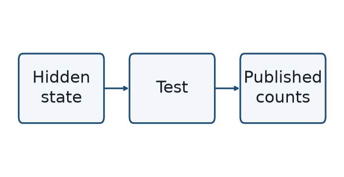
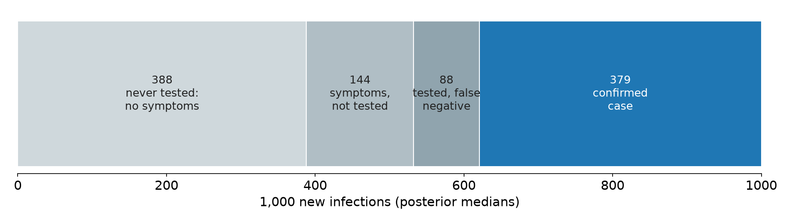
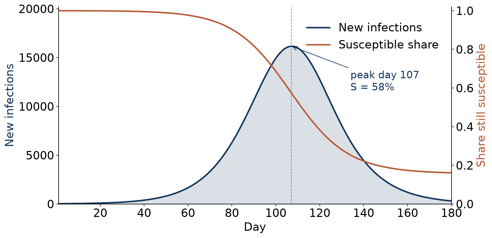
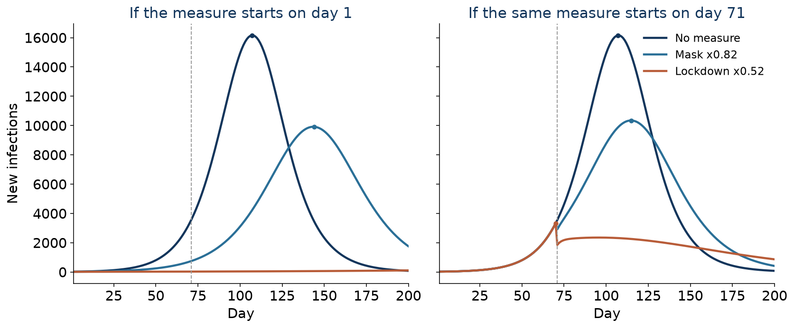
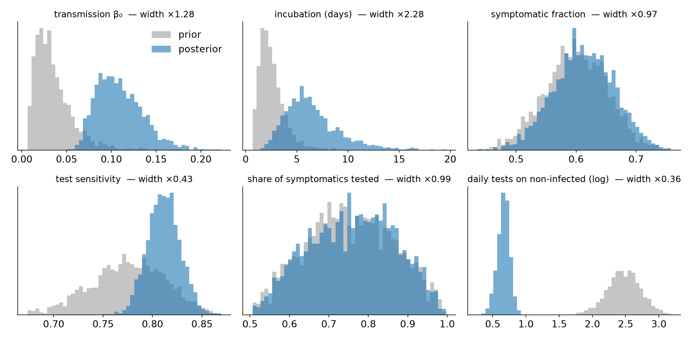
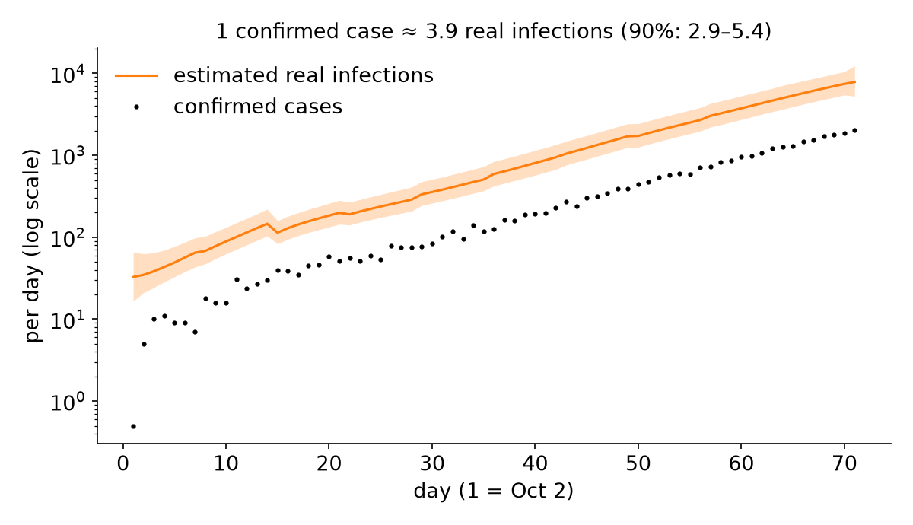
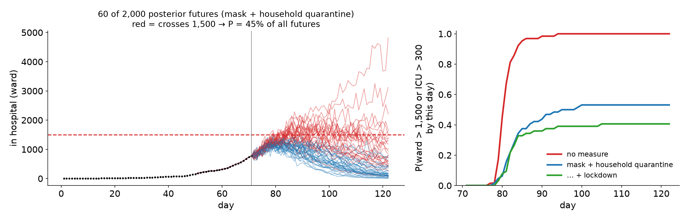
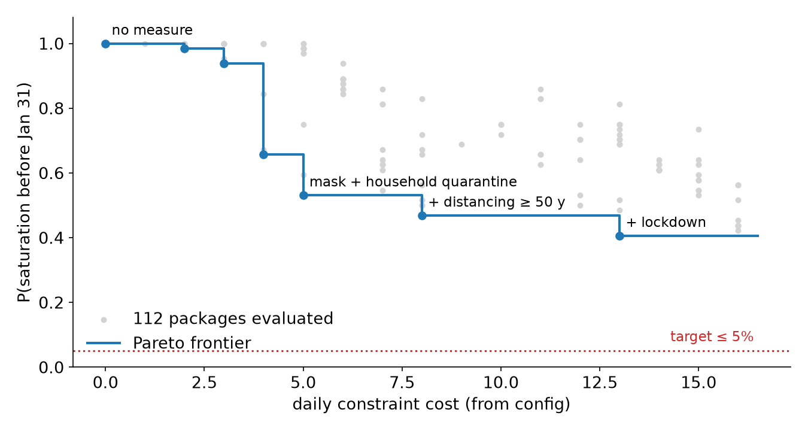

<!-- _class: title -->

# Steering a simulated epidemic with Bayesian forecasts

PROJ0016 · ULiège 2020 · 71 public days · NumPyro NUTS

<span class="small">Dimitri Marchand · https://github.com/dimiphoton/bigdataSIR</span>

<!--
The thread is a decision, not a method. One million people, published counts, and a hospital line that must not be crossed. Everything else is there to build the probability of crossing it.
-->

---

# A classical fit and a Bayesian inference name the same moves

| Classical habit | Bayesian equivalent | In this project |
|---|---|---|
| Fit | Inference | NUTS on 71 days, not a point $\hat\theta$ |
| Loss | Likelihood | Negative binomial on cases, tests, ward, ICU |
| L2 penalty | Gaussian prior | Log incubation, log $\beta$ |
| Best $\hat\theta$ | Posterior | 2,000 draws, not the median alone |
| Confidence interval | Credible interval | Incubation 2.4–10.4 days |
| Optimiser converged | $\hat R$, ESS | $\hat R$ up to 1.02, ESS down to 387 |
| Prediction | Posterior predictive | Fan of future ward counts |
| Hyperparameter search | Hierarchical prior | Severity by age, older group higher |
| Decision threshold | Probability of an event | Keep a measure only if P(saturation) ≤ 5% |

<!--
Read the table top to bottom, one row at a time. The point to leave behind: the result is not a best value. It is every value still compatible with the brief and with the 71 days.
-->

---

# IISc Bangalore and TIFR built a city of agents, not a compartment average

| | `cni-iisc/epidemic-simulator`, 2020 |
|---|---|
| Who | Indian Institute of Science, Bangalore, and TIFR Mumbai. Apache-2.0 |
| City | `CityGen.py` gives every person a home, a school, a workplace and a community centre, from age and commute distance |
| Example | A synthetic Mumbai. The documented run uses 10,000 agents. The C++ note cites 100,000 |
| Engines | A browser simulator, then C++ `drive_simulator` |
| Levers | 11 coded policies: none, case isolation, home quarantine, lockdown, and distancing of people over 65 or 70 |
| Their fit | `tune_model_CPP.py` tunes $\beta$ to a fatalities series |

<span class="small">Source: the repository README. This project does not run that code.</span>

<!--
This is the original Indian simulator, not our file. Two institutes built a synthetic city so they could try non-pharmaceutical interventions under Indian demographics. Each agent has a home, a school, a workplace and a community centre. They later rewrote the browser engine in C++. Their own calibration is a single beta tuned to deaths, which is the habit the next part of the talk leaves behind.
-->

---

# This project keeps the four places and the levers, and drops the agents

| | IISc simulator | This project |
|---|---|---|
| People | Agents in a generated Indian city | One fictional city of 1,000,000. No ward map |
| Contacts | Home, school, workplace, community, visited each day | The same four places, summed into one matrix |
| Policies | The 11 codes above | Those names, plus a mask. 112 packages |
| What is hidden | The agent state | $\beta$, durations, severity, testing rate |
| Estimation | One $\beta$ tuned to deaths | A posterior. The fit never reads their code |

<!--
Draw the line. We kept the geography of contact and the names of the measures. We did not keep the agents, the ward map, or their tuner. The rows in data.csv are a course reduction of that design. The inference model is smaller again: two age groups, no separate places, no presymptomatic stage.
-->

---

# The data come from an external simulator whose parameters are fixed, then hidden

| | Simulator (the city) | Inference model (what is fitted) |
|---|---|---|
| Who generates the rows | Course simulator, parameters drawn once | It never reads `.truth.json` |
| What is published | Cases, tests, ward, ICU, deaths | Those five columns only |
| Structure | 5 age groups, presymptomatic stage, daily binomial draws | 2 age groups, no presymptomatic stage, expectation step |
| What stays secret | $\beta$, durations, severity, testing rate | These are the unknowns |

<span class="small">Day 71 in `data/external/data.csv`: 2,035 confirmed, 2,539 tests, 774 in ward, 76 in ICU.</span>

<!--
Stress the separation from the IISc binary as well as from our own simulator. The parameters have already been drawn. The fit is not allowed to read them. The model being fitted is smaller than the city: two age groups, and no presymptomatic stage.
-->

---

# On day 71 the analyst sees tests, and has to choose



- Published that day: **774** in ward, **76** in ICU
- Cases are doubling every **9.6 days** (8.6–10.8)
- The limits to hold until 31 January: ward **< 1,500**, ICU **< 300**

<!--
Three facts, not a method. Infections are not observed. Doubling is still fast. Both ceilings come from the brief, not from me.
-->

---

# The work is five steps: prior, likelihood, posterior, forecast, decision

1. **Prior** — intervals from the brief, or a labelled assumption
2. **Likelihood** — negative binomial on the published series
3. **Posterior** — NUTS, 4 chains, draws kept only if the chains agree
4. **Forecast** — each draw is simulated forward with process noise
5. **Decision** — cheapest measure whose P(saturation) is ≤ 5%

<!--
This is the plan for the rest of the talk. Do not expand it. Steps 4 and 5 are the product. Steps 1 to 3 exist so that product is not a number that is too sure of itself.
-->

---

# Each person sits in one box; each day, some move to the next


<span class="small">Posterior medians on the arrows: incubation 6.5 days, 61% symptomatic, hospital risk 5% under 60 and 20% over 60.</span>

<!--
Walk the diagram once. The dashed loop is transmission. The bottom layer is testing: it does not change who is infected, it changes what is published. The percentages are posterior medians, not the hidden parameters.
-->

---

# One day: who gets infected, who leaves, and what is published

$$
\begin{aligned}
\lambda_g(t)
  &= \beta(t)\sum_j C_{gj}\,\frac{\kappa I_{a,j}(t)+I_{s,j}(t)}{N_j}\\[6pt]
n_g(t)
  &= S_g(t)\bigl(1-e^{-\lambda_g(t)}\bigr)\\[6pt]
\pi(d)
  &= 1-e^{-1/d}
\end{aligned}
$$

$$
\begin{aligned}
\mathbb{E}\!\left[Y^{+}(t)\right]
  &= \eta\, p_{\mathrm{test}}\, C^{\mathrm{sym}}(t)+A(t)\\[6pt]
H^{\mathrm{in}}_g(t)
  &= p_{\mathrm{hosp},g}\,\pi(d_I)\, I^{s}_g(t)\\[6pt]
U^{\mathrm{in}}_g(t)
  &= p_{\mathrm{icu},g}\,\pi(d_H)\, H_g(t)
\end{aligned}
$$

<span class="small">$\eta$ sensitivity. $A(t)$ admissions not already confirmed. Specificity fixed at 1.</span>

<!--
Read the two blocks in order. The first is who gets infected and who leaves a box. The second is what is written to the file, then the only link from infectious people to beds. Pi of d is the chance of leaving a stage whose mean length is d days.
-->

---

# Of 1,000 infections, about 380 become confirmed cases



<span class="small">Posterior medians: 388 never symptomatic, 144 symptomatic but untested, 88 false negatives, 379 confirmed.</span>

<!--
Testing looks only at symptomatic people, and not at all of them. At the posterior medians, 379 of 1,000 same-day infections are confirmed. That is not yet the factor of 3.9 at the end: a case published today was infected earlier, while incidence was still doubling.
-->

---

# $\beta$ is the transmission rate; $R_0$ is the offspring count while everyone is susceptible

$$
\begin{aligned}
R_0 &= \beta\, d_I \\[4pt]
R_e(t) &= R_0\, \frac{S(t)}{N}
\end{aligned}
$$

| | In the one-group step on the next slide |
|---|---|
| $\beta$ | **0.41 / day**, set so cases double every 9.6 days |
| Infectious spell $d_I$ | **4.9 days**, posterior median |
| $R_0$ | **1.99**. One case replaces itself about twice at the start |
| Threshold | new infections stop growing when $S = N/R_0$, here **50%** |

<span class="small">Fitted $\beta_0$ is 0.11 (0.07–0.15). It multiplies the contact matrix, so it is not 0.41.</span>

<!--
Beta is the rate of transmission. R0 is how many people one case infects while everyone is still susceptible. Re is that number once part of the city is immune: multiply by the share still susceptible. Above 1, incidence grows. Below 1, it falls. The 0.41 on this slide is not the fitted beta0. That one is 0.11, because it is then multiplied by the contact matrix.
-->

---

# New infections fall only after the susceptible stock thins, and the epidemic stops on its own



Day 71: $S=95\%$, so $R_e \approx 1.89$. Peak day **107**. This step infects **84%**. No measure.

<!--
The decision point: on day 71 the susceptible stock has barely moved, and Re is still about 1.9. The epidemic burns out later, around day 107, after this simplified step has infected 84% of the city. The classic final-size formula, at R0 of 1.99, gives about 79%. Waiting for that burnout means missing the hospital peak.
-->

---

# A lower $\beta$ flattens the peak; from day 71 the same cut comes late



| | Peak of new infections from day 1 | Same factor from day 71 |
|---|---|---|
| No measure, $R_0=1.99$ | 16,200 on day 107 | same |
| Mask $\times 0.82$, $R_0=1.63$ | 9,900 on day 144 | 10,300 on day 115 |
| Lockdown $\times 0.52$, $R_0=1.03$ | the wave does not take off | already 3,300, then it falls |

<span class="small">One-group new infections, not ward beds. The factors are those of the 112 packages.</span>

<!--
On the left, lowering beta from day 1 moves the peak down and later: that is flattening the curve. The project's mask multiplies beta by 0.82. Lockdown multiplies it by 0.52, and R0 falls to 1.03, so the wave does not take off. On the right, the same cut on day 71 arrives after growth is already under way. This figure counts infections, not beds. The lag into hospital is the one in the full model.
-->

---

# Priors come from the brief; anything else is marked as an assumption

| Parameter | Prior | Where it comes from |
|---|---|---|
| Incubation | Log-normal, central 90% = 1–5 days | Brief |
| Symptomatic spell before hospital | Log-normal, central 90% = 4–10 days | Brief |
| Symptomatic fraction | Beta, mean 0.60, range 0.50–0.70 | Brief |
| Test sensitivity | Beta, mean 0.78, range 0.70–0.85 | Brief |
| Share of symptomatics tested | $0.50 + 0.50\cdot\mathrm{Beta}(2,2)$ | Brief, floor at 50% |
| Hospital spell / ICU spell | Log-normal, medians 8 d and 10 d | Assumption |
| Severity by age | Logit-normal, older group higher | Assumption |
| Tests on people who are not infected | Log-normal, median **300 / day** | Assumption |

<!--
A prior is what we accept before the 71 days are seen. A duration is log-normal, so it stays positive and its central 90 percent matches an interval. A proportion is a Beta.

Read the table in two blocks. The first five rows are the brief. Incubation sits between 1 and 5 days. The symptomatic spell before hospital sits between 4 and 10. About 60 percent of infections become symptomatic. Test sensitivity sits around 78 percent, between 70 and 85. The testing rate has a floor at 50 percent, and above that floor the prior is almost flat.

The last three rows are not in the brief. They are marked as assumptions. Hospital and ICU stays are centred at 8 and 10 days. Severity is higher in the older group. Remember the last row: I put a median of 300 tests a day on people who are not infected. Nothing in the brief says that. The data will throw it out.
-->

---

# The update is visible on one parameter: the prior tightens as days are added


$$p(\theta \mid y) \propto p(y \mid \theta)\, p(\theta)$$

<span class="small">Toy update of sensitivity from positivity alone. The full model, which also allows tests on uninfected people, gives 0.81 (0.79–0.84).</span>

<!--
The figure is one parameter, so the product of prior and likelihood is visible. After 7 days the prior still weighs. After 71 days the toy is almost a spike. In the full model the interval stays 0.79 to 0.84, because other parameters can explain the same positives.
-->

---

# A forecast carries three uncertainties, and all three are kept

| Source | What is unknown | How it enters |
|---|---|---|
| Parameters | $\beta$, durations, risks | Width of the posterior; shrinks with data |
| Process | Who gets infected today is a draw | $\pi(d)=1-e^{-1/d}$ each day, and a weekly step on $\beta(t)$ |
| Observation | Tests miss people | Testing layer, then a negative binomial |

$$p(\tilde{y}\mid y)=\int p(\tilde{y}\mid\theta)\,p(\theta\mid y)\,\mathrm{d}\theta$$

About 2,000 posterior draws, each simulated with noise.

<!--
Keeping only the median of the parameters drops the last two rows and understates the risk. The saturation probability later in the talk is this integral, counted as a share of curves.
-->

---

# Inference is four NUTS chains started from the prior median

```python
kernel = NUTS(
    seirh_model,
    target_accept_prob=nuts.target_accept,
    init_strategy=init_to_median(num_samples=100),
)
mcmc = MCMC(
    kernel,
    num_warmup=nuts.num_warmup,
    num_samples=nuts.num_samples,
    num_chains=nuts.num_chains,
)
mcmc.run(key, **kwargs)
```

<span class="small">`src/epidemic/inference/fit.py`. Kept run: 4 chains, 1,000 warmup steps, 500 draws each, target accept 0.9.</span>

<!--
Show that the code is not searching for a minimum. It starts four walks that have to meet. init_to_median is there because a random start stuck the chains. The settings of the kept run are under the code, not the YAML defaults.
-->

---

# Four chains count only when they move through the same region


| | First attempt | Kept run |
|---|---|---|
| What the traces do | Flat, stuck apart | Overlapping, still moving |
| $\hat R$ | up to 15 | **1.02** (hospital spell) |
| ESS | 4 | **387** (hospital spell) |
| Divergences | — | **0** |

<span class="small">Own gates were $\hat R < 1.01$ and ESS ≥ 400. This run misses both, on the hospital duration.</span>

<!--
On the left, a flat chain is not exploring. That was not two modes. The step had collapsed after a bad start. On the right, the chains overlap. Still do not trust the hospital-stay interval: R-hat 1.02 and ESS 387, short of the gates I had set.
-->

---

# An inferred parameter is a density, drawn against its prior



<span class="small">Gray = prior, blue = posterior. The label is (posterior width) / (prior width). Under 0.50, the data pinned it.</span>

Only sensitivity (×0.43) and tests on uninfected people (×0.36) pass that bar.

<!--
Teach the panel before the conclusions. If blue covers gray, the data added nothing. If blue has moved and narrowed, they learned something. Here only two panels are actually tight.
-->

---

# The posterior predictive covers the four published series


<span class="small">Bands are the 90% posterior predictive, observation noise included. Deaths are in the likelihood and are not on this figure.</span>

Cases, tests and ward sit in the band. ICU is a bit high at the end: it is the smallest series.

<!--
This checks the likelihood, not the parameters. A model can reproduce the ward with the wrong durations, if the hospitalisation risk compensates. That is the next few slides.
-->

---

# The data pinned sensitivity, rejected the flu prior, and left two parameters alone

| Parameter | Posterior median (90%) | Width ratio | Reading |
|---|---|---|---|
| Sensitivity | **0.81** (0.79–0.84) | ×0.43 | Pinned. Positivity stays near 80% |
| Tests on uninfected / day | **4.7** (3.1–6.3) | ×0.36 | Prior median was 300. Rejected |
| $\beta_0$ | 0.11 (0.07–0.15) | ×1.28 | Moved, not tightened |
| Symptomatic fraction | 0.61 (0.54–0.70) | ×0.97 | Still the prior |
| Share tested | 0.76 (0.58–0.93) | ×0.99 | Still the prior |

<!--
Two clean results. Sensitivity is learned. The background of 300 tests a day on uninfected people was my assumption, and it is wrong: the posterior is about 5 a day. The last two rows did not move. We come back to them.
-->

---

# Incubation is pushed to 6.5 days, outside the 1–5 day brief

| | Days |
|---|---|
| Brief, central 90% of the prior | 1–5 |
| Posterior median | **6.5** |
| Posterior 90% interval | 2.4–10.4 |
| Width vs the prior | ×2.28, wider, not tighter |

The inference model has no presymptomatic box. The simulator gives that stage 1–3 days. The 6.5 days absorb a delay the model does not have.

<!--
Do not present 6.5 as a recovered incubation. The interval is wider than the prior and leaves the brief. It is a sign that a box is missing, not a finding about the virus.
-->

---

# Only the flow into hospital moved; stays and deaths stayed on the prior

| Passage | Posterior median (90%) | Prior it is judged against |
|---|---|---|
| Symptomatic spell, $I \to$ out | 4.9 d (2.8–6.7) | Brief 4–10 d |
| $I \to$ ward, under 60 / 60+ | **4.7%** (2.0–7.4) / **20%** (6–36) | Centred near 2%, older higher |
| Ward spell | 7.0 d (3.4–10.5) | Median 8 d. ESS 387, $\hat R$ 1.02 |
| Ward $\to$ ICU | 10% (3–18) / 32% (14–54) | Centred near 15% |
| ICU spell | 9.3 d (4.5–13.2) | Median 10 d |
| Death in ward | 0.9% (0.1–1.8) / 3.7% (0.1–7.5) | Centred near 2% |
| Death in ICU | 13% (1–24) / 34% (8–60) | Centred near 25% |

<!--
The only row that clearly moves is the hospitalisation risk, especially over 60, and its interval stays wide. Lengths of stay and death risks still cover their priors. Do not quote them as recovered parameters.
-->

---

# Testing rate and symptomatic fraction stay interchangeable

$$
\mathbb{E}\!\left[Y^{+}\right]
\propto
p_{\mathrm{test}}\, f_{\mathrm{sym}}\, \iota
$$

<span class="small">$f_{\mathrm{sym}}$ symptomatic fraction. $\iota$ new infections.</span>

| | Posterior 90% | Width ratio |
|---|---|---|
| Share of symptomatics tested | 0.58–0.93 | ×0.99 |
| Symptomatic fraction | 0.54–0.70 | ×0.97 |

Several pairs print the same confirmed cases. The ward series does not separate them either, once $p_{\mathrm{hosp}}$ can move.

<!--
Show the product. Double the testing rate and lower the symptomatic fraction, and the positives do not change. That is why both posteriors stayed on the prior. Separating them needs another series, for example serology.
-->

---

# One confirmed case stands for about 4 real infections



<span class="big">3.9</span> &nbsp; infections per confirmed case at the end of the 71 days

<span class="small">90% interval 2.9–5.4. The width is the unidentified testing rate from the previous slide.</span>

<!--
This is the useful quantity the model still produces: the hidden epidemic, with an interval. Do not present it as precise. It moves as soon as the testing rate moves, and that rate is not identified.
-->

---

# A probability is the share of plausible futures that cross the line



$$
P(\mathrm{sat})
=\frac{1}{M}\sum_{m=1}^{M}
\mathbf{1}\!\left\{\max_t H^{(m)}_t>1500
\;\mathrm{or}\;
\max_t U^{(m)}_t>300\right\}
$$

<span class="small">$M = 2000$ posterior trajectories. Red curves cross 1,500 ward beds.</span>

<!--
Read the formula as a count. There is no cutoff on an average curve: count the curves that cross. The figure shows which ones, and when. Inertia puts almost every crossing between days 78 and 90.
-->

---

# The alert score is P(saturation); a measure is kept only if it falls to 5% or below

$$
a^{\star}
=\operatorname*{arg\,min}_{a:\,P(\mathrm{sat}\mid a)\,\le\,0.05}
\operatorname{cost}(a)
$$

| Action from day 71 | Cost | P(saturation) | Median peak ward |
|---|---|---|---|
| None | 0 | **1.00** | 4,934 |
| Mask + 14-day household quarantine | 5 | **0.53** | 1,442 |
| That package + lockdown | 13 | **0.41** | 1,419 |

No row is ≤ 0.05. The alert stays on. The cheapest package that was scored still leaves a 53% chance of crossing a limit.

<!--
State the rule before the table. Keep a measure only if its probability falls to 5% or below, and among those pick the cheapest. Here that set is empty. The best row in the table is 53%, not 5%.
-->

---

# From day 71, no package brings that score under 5%



112 packages, scored on the same 2,000 trajectories. Delay 3 days, compliance 90%.

The lowest score is **41%** (mask, 14-day household quarantine, and lockdown). Adding distancing does not go lower.

<!--
The figure is the same calculation as the table, for all 112 packages. Show that the cloud never touches 5%. The reason is inertia: beds over the next two weeks are infections already under way on day 71.
-->

---

# Out of sample, the professor's simulator peaked where the forecast placed it


| | Ward peak | ICU |
|---|---|---|
| Seven published trajectories, strong measures | 1,198–1,286, around day 82 | 275–313 |
| This model's forecast under strong measures | median **1,255** (1,013–2,066) | the upper trajectories cross 300 |

The seven curves stay inside the band. One of them, Virus_buster, does cross 300 ICU beds.

<!--
This compares hospital trajectories, not parameters. The course simulator is more detailed than the model. The median peak lands among the seven published curves. The interval runs from about 1,000 to 2,000: the forecast contained the peak, it did not pin it down.
-->

---

# This model was not backtested, and this fit misses its own gates

| Gap | What is on file | What is missing |
|---|---|---|
| Chains | $\hat R$ 1.02, ESS 387, 0 divergences | Gates were 1.01 and 400 |
| Forecast score | Naive baselines cover **31%** of outcomes with a 90% band | The model's own rolling-origin score |
| Parameters | Posterior margins in `defense/summary_key.csv` | A recovery check against known parameters |

<!--
Three gaps, stated plainly. The chains are usable for the ward forecast and not clean enough for the length of stay. The 31% is the naive baselines, not this model. Nobody has checked the parameters on a city whose true values are known.
-->

---

# What I would change next

- **Add the presymptomatic stage.** Incubation at 6.5 days is that missing box, not a duration.
- **Separate testing rate from the symptomatic fraction.** Needs a series this file does not have.
- **Score the model the way the baselines were scored.** Refit at each week, then CRPS at 7, 14 and 21 days.

<!--
Each bullet is the defect from the matching slide: incubation, the testing-rate confusion, and the missing backtest. Do not add a fourth.
-->

---

# The chains caught a bad start, the prior caught a false flu rate, and the ward forecast held

- First NUTS run: $\hat R$ up to 15. The kept run overlaps, with ESS 387.
- The prior of 300 tests a day on uninfected people fell to **4.7**.
- Under strong measures the published peaks, 1,198–1,286, sit on the forecast median **1,255**.

<span class="small">NumPyro · JAX · ArviZ · 4 chains · 71 days · 2 age groups</span>

<!--
Close on three facts a least-squares fit would not have returned in the same way: a broken chain start, a numerical prior that was wrong, and a saturation probability rather than a single peak. The hospital peak did land in the right place, inside a wide interval.
-->
