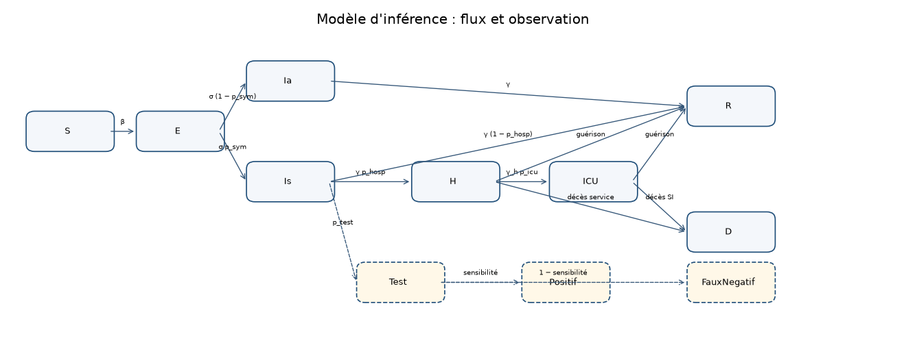
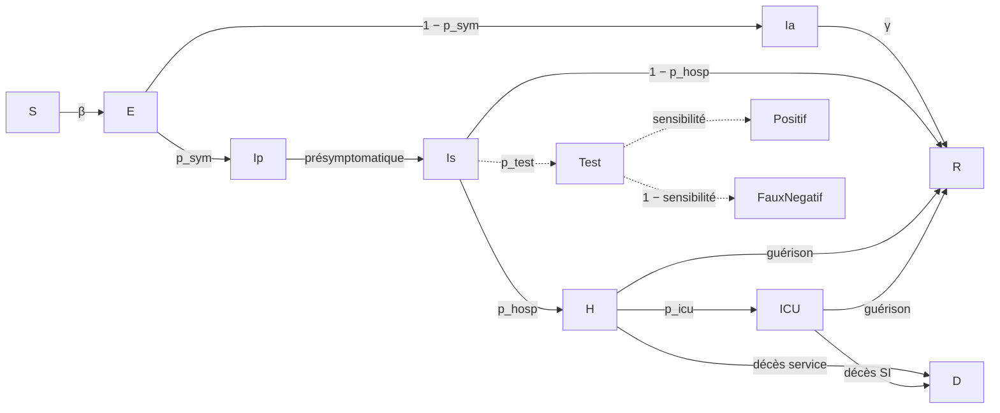
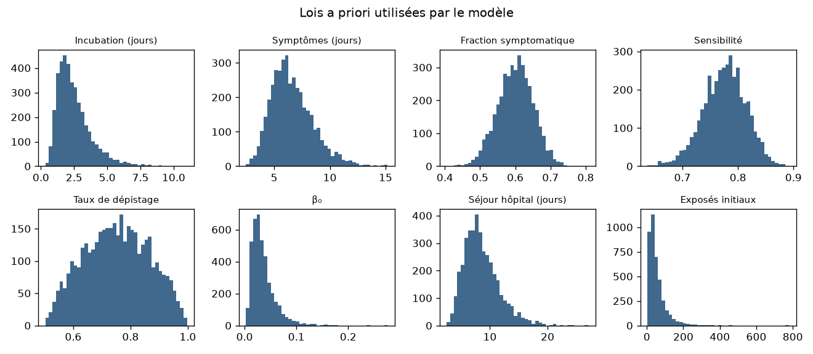
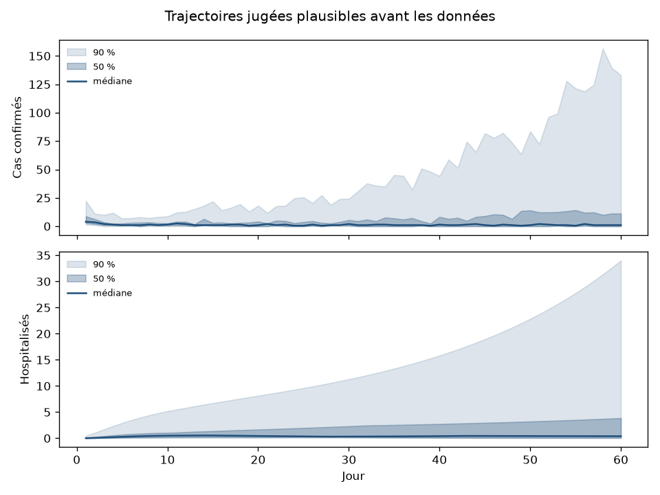
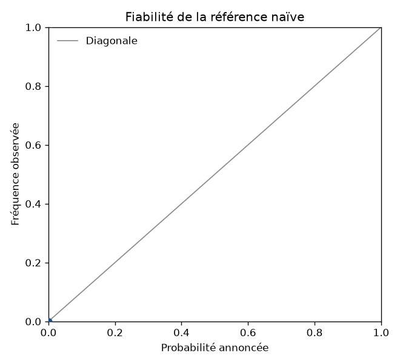
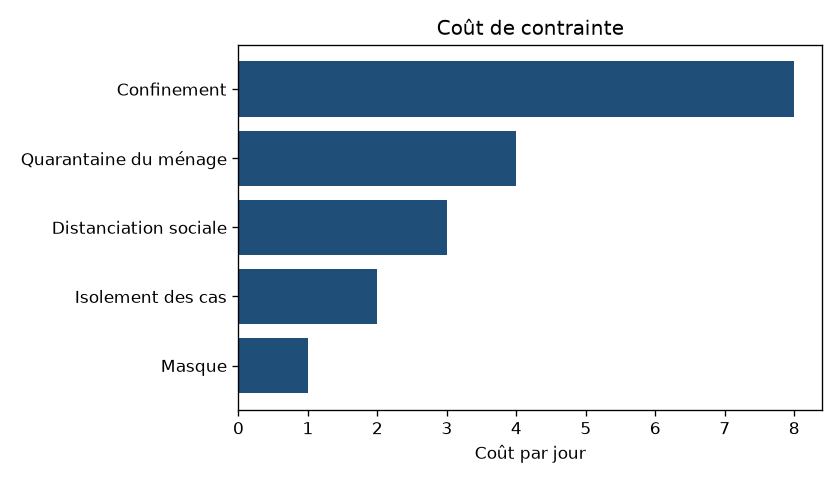

# Documentation du cadre bayésien

Ce texte est produit par `make docs`. Les chiffres, le tableau des priors et les figures viennent des fichiers de `configs/` et des calculs du projet. La graine utilisée est 0.

## 1. Pourquoi bayésien

**Intuition.** Une décision publique ne demande pas un seul chiffre « le plus probable ». Elle demande une probabilité : celle de dépasser 1 500 hospitalisés ou 300 lits de soins intensifs avant le 31 janvier 2021. Cette probabilité n'existe que si l'on a une loi sur les futurs possibles.

**Formalisation.** Après avoir vu les données \(y\), la loi des paramètres \(\theta\) est

\[
p(\theta \mid y) = \frac{p(y \mid \theta)\, p(\theta)}{p(y)}.
\]

\(p(\theta)\) est le prior, \(p(y \mid \theta)\) la vraisemblance, \(p(\theta \mid y)\) la loi a posteriori. Une prévision est une moyenne de trajectoires tirées dans cette loi, bruitées par le processus.

**Choix du projet.** Le rapport de 2020 ajustait des courbes par moindres carrés et produisait une trajectoire ponctuelle. Ici le prior reprend les plages des consignes, et la sortie utile est P(saturation), pas un résidu quadratique. Le seuil de décision par défaut est \(\alpha =\) 5 %.

**Ce qu'on en tire.** La règle retenue est : l'intervention la moins coûteuse telle que P(saturation) estimée reste au plus 5 %. Les autres seuils étudiés sont 1 %, 5 %, 10 %, 20 %.

## 2. Le problème

**Intuition.** La ville a 1 000 000 habitants. Le premier jour est le 2 octobre 2020, le dernier jour de jeu est le jour 122 (31 janvier 2021). Chaque jour on publie des cas confirmés, des tests, des hospitalisés, des soins intensifs et des décès. On ne publie pas le nombre d'infectés.

**Formalisation.** Trois états ne doivent pas être confondus. L'état infectieux est latent : susceptible, exposé, infectieux asymptomatique, infectieux symptomatique, hôpital, soins intensifs, rétabli, décédé. L'état de surveillance dit si la personne n'a pas été testée, a été testée négative, ou est un cas confirmé. Un faux négatif reste infectieux. Le facteur de sous-déclaration est le rapport entre infections réelles et cas confirmés.

**Choix du projet.** La sensibilité est entre 70 % et 85 %. La spécificité vaut 100 % par défaut. Au moins 50 % des symptomatiques sont testés. Les asymptomatiques ne le sont pas, sauf extension de dépistage, qui est éteinte. Toute hospitalisation non encore confirmée est comptée positive le jour de l'admission.

**Ce qu'on en tire.** Sur les 14 derniers jours de cas confirmés du fichier du cours, la pente de log(1 + cas) vaut 0,07 par jour, soit un temps de doublement d'environ 9,84 jours. Cette pente décrit les cas confirmés, pas les infections estimées.

## 3. Le modèle génératif

**Intuition.** On écrit d'abord comment l'épidémie avance, puis comment les tests la voient. Le modèle d'inférence est volontairement plus pauvre que la ville : il n'a pas de stade présymptomatique.

**Formalisation.** Par groupe d'âge, le pas d'un jour est une chaîne d'espérances. La probabilité de quitter un stade de durée moyenne \(d\) est \(1 - e^{-1/d}\). La force d'infection du groupe \(g\) est

\[
\lambda_g(t) = \beta(t) \sum_j C_{gj} \frac{I_{a,j}(t)\,\kappa + I_{s,j}(t)}{N_j},
\]

où \(C\) est la matrice de contact, \(\kappa\) la contagiosité relative des asymptomatiques, et \(N_j\) la population du groupe. Les nouveaux cas confirmés attendus valent

\[
\mathbb{E}[\text{positifs}(t)] = \text{sensibilité} \times p_{\text{test}}(t) \times \text{nouveaux symptomatiques}(t) + \text{admissions non encore confirmées}(t).
\]

Les tests ajoutent un fond de syndromes grippaux, des personnes non infectées. Avec une spécificité de 100 %, ces tests sont négatifs.

**Choix du projet.** Il y a 2 groupes d'âge. Les séries publiées ne sont pas ventilées par âge : la séparation entre groupes vient du prior et de la matrice de contact, pas d'une observation directe. \(\beta(t)\) est, dans le réglage actuel, une marche aléatoire hebdomadaire. La variante A est le défaut : seul \(\beta(t)\) bouge, et la concentration de la binomiale négative est fixée à 100. La variante B laisse bouger le taux de dépistage et estime la surdispersion. La variante C ajoute un bruit normal d'échelle binomiale sur les nouvelles infections. La vraisemblance par défaut est une binomiale négative, parce qu'une Poisson sous-estime la variance d'un comptage épidémique.

**Ce qu'on en tire.** Le schéma ci-dessous est dessiné depuis la liste des flux du code. Les flèches en pointillés sont l'observation.



```mermaid
flowchart LR
    S -->|β| E
    E -->|σ (1 − p_sym)| Ia
    E -->|σ p_sym| Is
    Ia -->|γ| R
    Is -->|γ p_hosp| H
    Is -->|γ (1 − p_hosp)| R
    H -->|γ_h p_icu| ICU
    H -->|guérison| R
    H -->|décès service| D
    ICU -->|guérison| R
    ICU -->|décès SI| D
    Is -.->|p_test| Test
    Test -.->|sensibilité| Positif
    Test -.->|1 − sensibilité| FauxNegatif
```

Le simulateur, lui, garde un stade présymptomatique :



Le DAG NumPyro (`numpyro.render_model`) est tenté au moment de l'ajustement. Sans Graphviz, le schéma de compartiments et le tableau des priors restent la référence.

## 4. Les priors, un par un

**Intuition.** Avant les données, le modèle ne doit produire que des épidémies compatibles avec ce que les consignes rendent plausible. Une proportion reçoit une loi Beta. Une durée strictement positive reçoit une loi log-normale, calée pour que l'intervalle des consignes soit un intervalle central.

**Formalisation.** Pour une log-normale, si l'intervalle central à 90 % vaut \([a, b]\), alors \(\mu = (\log a + \log b) / 2\) et \(\sigma = (\log b - \log a) / (2 z_{0,90})\). Pour une Beta de moyenne \(m\) et d'écart-type \(s\), \(\alpha = m\kappa\) et \(\beta = (1-m)\kappa\) avec \(\kappa = m(1-m)/s^2 - 1\).

**Choix du projet.** L'incubation va de 1 à 5 jours, la période symptomatique avant l'hôpital de 4 à 10 jours, la fraction symptomatique de 50 % à 70 %. Le taux de dépistage est une Beta décalée au-dessus de 50 %, peu informative au-dessus de ce plancher. Les taux de gravité sont des logit-normales hiérarchiques : les groupes partagent une moyenne, et une pente d'âge strictement positive rend le prior des plus âgés plus haut. Ce qui n'est pas dans les consignes est marqué « hypothèse » et repris dans `docs/hypotheses.md`.

**Ce qu'on en tire.** Intervalle à 95 % calculé depuis les paramètres du code, pas saisi à la main.

| Paramètre | Loi | Paramètres | Intervalle à 95 % | Source | Justification |
|---|---|---|---|---|---|
| Durée d'incubation | Log-normale | μ = 0.80, σ = 0.49 | 2,24 (0,86 à 5,83 j) | consigne | L'intervalle central à 90 % vaut 1 à 5 jours. |
| Durée symptomatique | Log-normale | μ = 1.84, σ = 0.28 | 6,32 (3,66 à 10,9 j) | consigne | L'intervalle central à 90 % vaut 4 à 10 jours, avant l'hôpital. |
| Fraction symptomatique | Beta | α = 54.7, β = 36.5 | 0,60 (0,50 à 0,70) | consigne | Moyenne 0,60, pour couvrir 50 à 70 % des infectés. |
| Sensibilité des tests | Beta | α = 91.5, β = 26.6 | 0,78 (0,70 à 0,85) | consigne | Moyenne 0,775, pour couvrir 70 à 85 %. |
| Taux de dépistage | Beta décalée | 0,50 + 0,50 × Beta(2, 2) | 0,75 (0,55 à 0,95) | consigne | Plancher de 50 % (consigne). La forme au-dessus est peu informative. |
| Spécificité des tests | Fixée, ou Beta | 1, ou Beta(199, 1) si on l'estime | 1 (fixée) | consigne | Les consignes donnent 100 %. L'estimation est une analyse de sensibilité. |
| Transmission β₀ | Log-normale | μ = -3.51, σ = 0.60 | 0,03 (0,01 à 0,10) | hypothèse | Par contact pondéré. La médiane 0,03 vise un R de l'ordre de 1. |
| Volatilité hebdomadaire de β | Demi-normale | échelle 0.15 | 0,10 (0,00 à 0,34) | hypothèse | La marche aléatoire hebdomadaire reste modérée. |
| Saut de β entre deux dates | Demi-normale | échelle 0.8 | 0,54 (0,02 à 1,81) | hypothèse | En mode constant par morceaux, un changement peut être fort. |
| Contagiosité des asymptomatiques | Beta | α = 2, β = 2 | 0,50 (0,09 à 0,91) | hypothèse | Relative aux symptomatiques, moyenne 0,5, sans borne dans les consignes. |
| Durée d'hospitalisation | Log-normale | médiane 8 j, σ = 0.35 | 8,00 (4,03 à 15,9 j) | hypothèse | Les consignes ne donnent pas la durée de séjour. |
| Durée en soins intensifs | Log-normale | médiane 10 j, σ = 0.35 | 10,0 (5,04 à 19,9 j) | hypothèse | Les consignes ne donnent pas la durée de séjour. |
| Probabilité d'hospitalisation | Logit-normale hiérarchique | moyenne logit -3.89, échelle 1.0 | 0,02 (0,00 à 0,13) | hypothèse | Autour de 2 % chez les plus jeunes. Pas de chiffre dans les consignes. |
| Pente d'âge de la gravité | Log-normale | μ = 0.41, σ = 0.35 | 1,50 (0,76 à 2,98) | consigne du projet | Les plus âgés ont un prior plus élevé. La pente est positive. |
| Passage en soins intensifs | Logit-normale hiérarchique | moyenne logit -1.73 | 0,15 (0,02 à 0,55) | hypothèse | Parmi les sorties d'hôpital, autour de 15 %, même pente d'âge. |
| Décès en service | Logit-normale hiérarchique | moyenne logit -3.89 | 0,02 (0,00 à 0,13) | hypothèse | Parmi les sorties d'hôpital qui ne vont pas en soins intensifs. |
| Décès en soins intensifs | Logit-normale hiérarchique | moyenne logit -1.10 | 0,25 (0,04 à 0,71) | hypothèse | Parmi les sorties de soins intensifs. |
| Exposés initiaux | Log-normale | μ = 3.69, σ = 0.8 | 40,0 (8,34 à 192) | hypothèse | Quelques dizaines de personnes au jour 0, réparties comme la population. |
| Part initiale déjà infectieuse | Beta | α = 2, β = 5 | 0,26 (0,04 à 0,65) | hypothèse | Moins d'infectieux que d'exposés au départ. |
| Fond de syndromes grippaux | Log-normale | μ = 5.70, σ = 0.6 | 300 (92,6 à 972) | hypothèse | Tests de personnes non infectées. Les consignes ne donnent pas le niveau. |
| Surdispersion des observations | Log-normale | μ = 3.40, σ = 0.7 | 30,0 (7,61 à 118) | hypothèse | Variante B seulement. Variante A : concentration fixée dans le YAML. |
| Bruit de la dynamique latente | Demi-normale | échelle 1.0 | 0,68 (0,03 à 2,24) | hypothèse | Variante C : bruit normal, en écarts-types binomiaux. |



La vérification a priori fait tourner 12 trajectoires de 60 jours. Les paramètres sont tirés dans ces lois, la dynamique est le scan du modèle, et les cas confirmés reçoivent un bruit gamma-Poisson de concentration 100.



## 5. L'inférence

**Intuition.** La loi a posteriori n'a pas de formule fermée : le dénominateur \(p(y)\) est une intégrale sur tous les paramètres et toutes les trajectoires. On ne la calcule pas. On en tire des échantillons.

**Formalisation.** NUTS est un Hamiltonian Monte Carlo. Une bille lancée sur la surface d'énergie \(-\log p(\theta, y)\) suit une trajectoire qui explore les zones probables. JAX dérive cette énergie à travers le scan, donc à travers la simulation d'un jour. Les marches aléatoires de \(\beta\) sont écrites en variables non centrées, et plusieurs paramètres positifs sont échantillonnés sur l'échelle log.

**Choix du projet.** La méthode par défaut est nuts, avec 4 chaînes, 500 pas d'échauffement et 500 tirages. Le SVI (2 000 pas) sert aux essais courts. Il ne fournit ni R̂ ni ESS.

**Ce qu'on en tire.** Aucun fichier .nc dans le dossier d'inférence. Les comparaisons entre prior et posterior, le R̂ et l'ESS apparaissent après epidemic fit.

## 6. Diagnostics

**Intuition.** Des chaînes qui n'ont pas exploré la même région ne doivent pas servir à une décision. On le vérifie avant de projeter.

**Formalisation.** Le R̂ compare la variance entre les chaînes à la variance dans chaque chaîne. Il doit rester sous 1,01. L'ESS estime le nombre de tirages indépendants. Il doit rester au moins à 400. Une divergence signale une région où la trajectoire hamiltonienne a échoué. Le maximum autorisé est 0. Si un seuil est dépassé, l'ajustement NUTS s'arrête.

**Choix du projet.** Ces seuils sont dans `configs/inference.yaml`. Les traces et les densités prior / posterior sont écrites à côté du fichier `.nc` quand `save_plots` est vrai.

**Ce qu'on en tire.** R̂ du dernier fichier lu : non calculé. ESS minimum : non calculé. Divergences : non calculé.

## 7. Ce que les données ont appris

**Intuition.** Un paramètre est bien identifié si les données rétrécissent fortement son intervalle. S'il reste aussi large qu'a priori, c'est le prior qui parle, pas les observations.

**Formalisation.** On compare la largeur a posteriori à la largeur a priori. Si ce rapport est sous 0,50, le paramètre est lu comme bien identifié. Entre 0,50 et 0,85, il est partiellement identifié. Au-dessus, il est dicté par le prior. Les paires dépistage × hospitalisation, ou \(\beta\) × fraction symptomatique, peuvent rester liées : plusieurs combinaisons prédisent les mêmes cas confirmés.

**Choix du projet.** La courbe d'apprentissage réajuste le modèle aux jours 7, 14, 21, 28, 35, 42, 49, 56, 63, 70. Elle n'est chiffrée dans ce document que lorsqu'un posterior est présent. Ajouter les hospitalisations, puis le taux de positivité, réduit en principe l'ambiguïté, parce que l'hôpital informe la gravité et le taux de positivité informe le fond de tests.

**Ce qu'on en tire.** Aucun fichier .nc dans le dossier d'inférence. Les comparaisons entre prior et posterior, le R̂ et l'ESS apparaissent après epidemic fit. Aucun score de posterior n'est enregistré. Les couvertures de cette section sont celles des références naïves, persistance et croissance exponentielle, pas encore celles du modèle.

## 8. Vérifications

**Intuition.** On demande au modèle de retrouver des paramètres qu'on a soi-même tirés, puis de prévoir des jours qu'on lui cache.

**Formalisation.** La couverture à 90 % est la part des vraies valeurs qui tombent dans l'intervalle central à 90 %. Le CRPS compare tout l'ensemble de prévision à la valeur réalisée. Le backtesting ajuste jusqu'au jour \(t\) et score les horizons 7, 14 et 21 jours contre la persistance et une croissance exponentielle.

**Choix du projet.** Le tableau ci-dessous n'est pas encore ce backtesting du modèle. C'est la même grille d'horizons 7, 14, 28, appliquée aux références naïves, sur les cas confirmés du cours et sur des villes simulées. Ainsi le calcul de couverture, de CRPS et de Brier est exécutable sans un NUTS de plusieurs heures. Aucun score de posterior n'est enregistré. Les couvertures de cette section sont celles des références naïves, persistance et croissance exponentielle, pas encore celles du modèle.

**Ce qu'on en tire.** Intervalles à 90 % : 31 % de réussite sur 80 prévisions. Intervalles à 50 % : 24 %. Les intervalles sont trop sûrs d'eux : la valeur réalisée tombe dedans moins souvent que le niveau annoncé. Le score de Brier des événements « hospitalisés au-dessus de 1 500 dans les 28 jours » vaut 0,00 pour la persistance. Sur cette série, le plafond d'hospitalisés n'est pas franchi dans les fenêtres scorées, et la persistance ne l'annonce presque pas. Le Brier est donc bas sans mesurer un événement qui arrive vraiment. Le CRPS moyen vaut 144 pour la persistance et 135 pour la croissance exponentielle, sur 80 prévisions.

| Série | Horizon (jours) | Prévisions | Couverture 50 % | Couverture 90 % | CRPS persistance | CRPS exponentielle |
|---|---:|---:|---:|---:|---:|---:|
| nouveaux décès | 7 | 8 | 88 % | 100 % | 0,43 | 0,51 |
| nouveaux décès | 14 | 7 | 86 % | 86 % | 0,67 | 0,68 |
| nouveaux décès | 28 | 5 | 60 % | 60 % | 1,26 | 1,16 |
| soins intensifs | 7 | 8 | 25 % | 38 % | 6,73 | 9,78 |
| soins intensifs | 14 | 7 | 14 % | 29 % | 12,4 | 29,0 |
| soins intensifs | 28 | 5 | 0 % | 0 % | 26,0 | 172 |
| hospitalisés | 7 | 8 | 0 % | 0 % | 83,7 | 46,6 |
| hospitalisés | 14 | 7 | 0 % | 0 % | 151 | 115 |
| hospitalisés | 28 | 5 | 0 % | 0 % | 285 | 168 |
| cas confirmés | 7 | 8 | 0 % | 38 % | 200 | 26,8 |
| cas confirmés | 14 | 7 | 0 % | 0 % | 394 | 113 |
| cas confirmés | 28 | 5 | 0 % | 0 % | 748 | 1 320 |

Même calcul sur une trajectoire publique par niveau de stochasticité, graine 0. Le modèle ne lit pas le fichier secret de ces trajectoires.

| Trajectoire | Prévisions | Couverture 90 % | CRPS persistance | CRPS exponentielle | Brier |
|---|---:|---:|---:|---:|---:|
| niveau 0 | 32 | 69 % | 11,9 | 3,70 | 0,00 |
| niveau 1 | 32 | 50 % | 16,8 | 6,58 | 0,00 |
| niveau 2 | 32 | 53 % | 25,6 | 10,2 | 0,00 |
| niveau 3 | 32 | 44 % | 21,9 | 33,1 | 0,00 |



## 9. De la loi a posteriori à la décision

**Intuition.** Une fois les paramètres tirés, on rejoue l'avenir avec du bruit. Deux futurs peuvent partager les mêmes paramètres et diverger. P(saturation) est la part de ces futurs qui touchent un plafond.

**Formalisation.** La loi prédictive a posteriori est

\[
p(y_{\text{futur}} \mid y) = \int p(y_{\text{futur}} \mid \theta)\, p(\theta \mid y)\, d\theta.
\]

Une intervention devient un facteur sur \(\beta\), calculé depuis les matrices de contact par lieu. Le masque se multiplie avec les autres mesures. Quand on combine des mesures de contact, c'est la réduction la plus forte qui s'applique. L'isolement des cas et la quarantaine du ménage sont incompatibles. Le respect moyen est 90 %. Le masque réduit le taux d'infection de 20 % avant ce respect. Le délai de mise en œuvre est 3 jours, et une mesure dure au moins 14 jours.

**Choix du projet.** La recommandation minimise le coût cumulé sous P(saturation) ≤ 5 %. Les durées d'isolement étudiées sont 7, 10, 14 jours. Les âges seuils de la distanciation sont 50, 60, 70 ans. Une règle conditionnelle active une mesure si un indicateur observé, donc bruité, dépasse un seuil haut, et la lève s'il repasse sous un seuil bas. Elle ne voit pas l'état latent. Le palier 2 peut s'ouvrir avant la date si P(H > 750 dans les 28 jours) dépasse 20 %. Le palier 3 peut s'ouvrir si P(saturation) dépasse 20 %.

**Ce qu'on en tire.** Coûts journaliers lus dans la configuration du jeu. La frontière coût / risque des scénarios est tracée quand un posterior est chargé dans l'application. Sans ce fichier, le graphe ci-dessous est l'échelle de coût, pas une probabilité inventée.

| Mesure | Coût par jour |
|---|---:|
| Masque | 1,00 |
| Isolement des cas | 2,00 |
| Distanciation sociale | 3,00 |
| Quarantaine du ménage | 4,00 |
| Confinement | 8,00 |



Les projections affichées dans un bulletin couvrent 14, 28 jours. Les éventails du modèle (médiane, 50 %, 90 %) portent sur les hospitalisés, les soins intensifs, les décès, les cas confirmés et Rt.

## 10. Calibration

**Intuition.** Annoncer 90 % ne vaut rien si la réalité ne tombe dans l'intervalle que six fois sur dix. On compare donc les probabilités annoncées aux fréquences observées, après coup.

**Formalisation.** La couverture empirique est le nombre de réussites divisé par le nombre de prévisions. Le diagramme de fiabilité regroupe les probabilités annoncées par classes et y porte la fréquence observée. Le score de Brier est la moyenne de \((p - y)^2\), où \(y\) vaut 0 ou 1. Le CRPS fait la même idée pour une série continue.

**Choix du projet.** Pour chaque bulletin, chaque horizon parmi 7, 14, 28 jours, et chaque série (cas confirmés, hospitalisés, soins intensifs, nouveaux décès), on regarde si la valeur réalisée tombe dans l'intervalle à 50 % et dans l'intervalle à 90 %. L'interprétation utilise une tolérance autour du niveau nominal : en dessous, les intervalles sont trop sûrs d'eux ; au-dessus, ils sont trop prudents.

**Ce qu'on en tire.** Intervalles à 90 % : 31 % de réussite sur 80 prévisions. Intervalles à 50 % : 24 %. Les intervalles sont trop sûrs d'eux : la valeur réalisée tombe dedans moins souvent que le niveau annoncé. Aucun score de posterior n'est enregistré. Les couvertures de cette section sont celles des références naïves, persistance et croissance exponentielle, pas encore celles du modèle.

## 11. Limites et hypothèses

**Intuition.** Le modèle est plus simple que la ville. Cet écart est voulu : sinon l'inférence tricherait en voyant la vérité.

**Formalisation.** La ville a un stade présymptomatique, des contacts par lieu, et, aux niveaux 2 et 3, une dérive de \(\beta\) et une hétérogénéité individuelle. Le modèle d'inférence agrège cela dans \(\beta(t)\) et dans la surdispersion. Les faux négatifs restent infectieux dans la ville. Le modèle les compte, il ne les retire pas des infectieux.

**Choix du projet.** Le texte qui suit est recopié depuis `docs/hypotheses.md` au moment de la génération.

**Ce qu'on en tire.**

# Hypothèses du simulateur

Ce fichier liste ce qui n'est pas fixé par les consignes du cours. Le futur modèle d'inférence ne lit ni ce simulateur, ni `data/generated/.truth.json`.

## Structure

La ville est découpée en cinq tranches : 0-17, 18-49, 50-59, 60-69 et 70 ans et plus. Les seuils 50, 60 et 70 tombent sur des bords de tranche. L'âge 80 du fichier `age.json` regroupe les 80 ans et plus ; il est traité comme l'âge 80.

L'école concerne les 3-17 ans, avec une participation de 95 %. Le travail concerne les 18-64 ans, avec une participation de 70 %. Ces deux taux sont dans `configs/simulator.yaml`.

## Contacts

Les matrices viennent de `stats/*.json`.

- Domicile : une personne a en moyenne autant de contacts que de cohabitants. Les âges se mélangent au hasard dans le ménage. Il n'y a pas d'assortativité par âge.
- École, travail, communauté : le degré vaut `min(plafond, taille du groupe - 1)`, pondéré par les personnes. Les écoles et les quartiers sont grands, donc le plafond est presque toujours atteint. Les plafonds (15, 15 et 4) représentent des contacts effectifs par jour, pas la taille du groupe.
- Un poids par lieu module la transmission : domicile 1, école 0,45, travail 0,45, communauté 0,25.

## Compartiments et durées

Les consignes donnent l'incubation (1 à 5 jours) et la période symptomatique avant hospitalisation (4 à 10 jours). Le reste est choisi ici, puis tiré dans une plage :

- présymptomatique infectieux : 1 à 3 jours ;
- asymptomatique infectieux : même plage que la période symptomatique, avec une contagiosité relative de 0,4 à 0,8 ;
- séjour en hôpital : 6 à 12 jours ;
- séjour en soins intensifs : 7 à 14 jours ;
- pas de transmission depuis l'hôpital ni les soins intensifs.

La gravité par âge (hospitalisation, passage en soins intensifs, décès) est dans `configs/simulator.yaml`. Elle est choisie pour qu'une vague puisse approcher 1 500 hospitalisés et 300 lits de soins intensifs, sans que ce soit automatique.

En temps discret, la probabilité de quitter un stade est `1 - exp(-durée^-1)`. La durée moyenne est un peu plus longue qu'une loi géométrique de paramètre `1 / durée`. Au niveau 3, chaque durée est une somme de stades gamma de même moyenne.

## Aléa

Quatre générateurs partent de la même graine : paramètres, démographie, environnement, individus. Une graine fixe donne la même trajectoire pour un même niveau. Les paramètres secrets tirés dans les plages des consignes ne dépendent pas du niveau.

- Niveau 1 : chaîne binomiale quotidienne.
- Niveau 2 : en plus, β(t) suit un Ornstein-Uhlenbeck sur log β (volatilité 5 % par jour, retour vers la moyenne), le taux de test et le fond grippal dérivent, et la sensibilité varie un peu d'un jour à l'autre. La saisonnalité est éteinte par défaut.
- Niveau 3 : en plus, la contagiosité agrégée suit une gamma de dispersion k entre 0,1 et 0,5, le respect des mesures varie autour de 90 %, et les durées deviennent gamma.

Chaque source peut être forcée à vrai ou faux dans le YAML. `null` suit le niveau.

## Observation

Trois états de surveillance : non testé, testé négatif, testé positif. Seuls les nouveaux symptomatiques sont testés, avec une probabilité tirée entre 50 et 85 %. Les asymptomatiques et les présymptomatiques ne le sont pas, sauf si `extended_screening_rate` est supérieur à 0. Il vaut 0.

Un faux négatif reste infectieux et ne déclenche pas l'isolement. Une admission jamais confirmée est comptée positive le jour de l'entrée, et compte aussi comme un test. La spécificité vaut 100 % dans les priors ; on peut la baisser dans `configs/priors.yaml`. Le plafond de tests journaliers est 20 000. Les tests hors hôpital sont réduits s'il est atteint. Les admissions restent comptées.

## Interventions

Le respect de 90 % réduit l'effet moyen des mesures générales : un confinement de −75 % au travail retire en moyenne 67,5 % des contacts. Pour une personne qui s'isole vraiment, la réduction est la plus forte entre la mesure générale et l'isolement, appliquée une seule fois au contact. Le masque multiplie le taux d'infection par `1 - 0,9 × 0,20`. Il ne passe pas par la règle du maximum.

L'isolement et la quarantaine portent sur les cas confirmés, pas sur les faux négatifs. La durée demandée (7, 10, 14 jours…) est comparée à la durée symptomatique : la part des symptomatiques confirmés qui s'isolent vaut `min(1, durée / durée symptomatique)`. On ne garde pas un ménage en quarantaine après la guérison de l'index. La quarantaine d'un ménage touche aussi une fraction des autres personnes, estimée par `cas confirmés × (taille moyenne du ménage - 1) / population`.

`isolate_on_symptoms` est faux : un symptomatique non testé ne s'isole pas tout seul.

## Calendrier et score

Le bulletin du jour 70 prend effet le jour 75, et non trois jours plus tard. Les autres bulletins gardent le délai de 3 jours. Une mesure peut être levée à un bulletin une fois le jour courant au moins égal à son quatorzième jour d'effet. La levée prend effet après le même délai.

Le score additionne, pour chaque jour, le coût de chaque mesure active. Les coûts sont dans `configs/game.yaml`. Ils ne viennent pas des consignes. Les effets épidémiologiques, eux, ne s'additionnent pas : c'est la plus forte réduction qui s'applique, puis le masque.

La saturation compare `num_hospitalised` à 1 500 et `num_critical` à 300, comme les colonnes publiées. Les hospitalisés hors soins intensifs et les soins intensifs sont donc deux stocks séparés.

Le déblocage anticipé des paliers 2 et 3 utilise les probabilités du bulletin quand un posterior est chargé dans l'application. Sans ce fichier, seules les dates du calendrier débloquent les paliers.

## Projections et décision

Le modèle d'inférence a un seul β. Une intervention est traduite en matrice de contact, construite à partir des quatre lieux. Cette matrice est le rapport entre la politique choisie et la politique déjà en cours : β(t) porte déjà l'effet des mesures passées, et on ne le compte pas une seconde fois.

L'isolement des cas et la quarantaine du ménage ne concernent qu'une part des infectieux. Au point de référence, cette part vaut fraction symptomatique 0,60 × probabilité de confirmation 0,55 × min(1, durée / 10 jours). Dix jours est le haut de `symptomatic_before_hospital_days` dans les priors : 7 jours ne couvrent pas toute la plage, 10 et 14 jours la couvrent entièrement. La quarantaine multiplie par la taille moyenne du ménage, puis on tronque à 1. Ces trois nombres, et les poids de transmission des lieux, ne sont pas dans les consignes. On les fait varier : Dirichlet de concentration 40 autour des poids de `configs/simulator.yaml`, et lois normales autour du point de référence (`configs/decision.yaml`). Le rapport des facteurs multiplie β, une fois la matrice moyenne fixée.

Le coût utilisé pour classer est un coût cumulé. Pendant le délai de mise en œuvre, la politique en cours continue de coûter. Ensuite, c'est le paquet choisi. Les coûts journaliers sont ceux de `configs/game.yaml`. La durée d'isolement et l'âge seuil changent l'effet, pas le coût d'un jour.

Les jours futurs des variantes A et B reçoivent un bruit normal d'échelle binomiale sur les nouvelles infections, même si `process_sigma` vaut 0 dans l'ajustement. Les chocs des jours déjà ajustés restent nuls. Le taux de dépistage est prolongé à sa dernière valeur a posteriori.

Une règle conditionnelle est évaluée en boucle fermée. À chaque jour elle ne voit que des observations bruitées (hospitalisés, soins intensifs, cas sur 7 jours, positivité sur 7 jours). Le franchissement du seuil haut programme l'activation après le délai du jeu. La levée demande que l'indicateur reste sous le seuil bas pendant N jours, et que la mesure ait déjà duré au moins 14 jours. La grille par défaut ne fait varier que les seuils d'hospitalisés, pour que le calcul reste court. Les autres indicateurs sont dans le YAML.

P(saturation) compare les stocks bruités aux plafonds 1 500 et 300, parce que ce sont les séries publiées qui définissent la saturation. Les jours déjà publiés sont recollés tels quels. Rt affiché reste le proxy β × contacts × durée infectieuse × S/N.

La sensibilité à alpha reclasse les mêmes trajectoires. La sensibilité au taux de respect et à la fraction symptomatique est rapportée par le facteur de transmission. On ne relance pas un MCMC à chaque changement de prior.


## Mode cours

Avec `observation_source: course`, les 71 jours de `data/external/data.csv` remplacent les observations publiées. L'état caché continue d'être simulé et ne coïncide pas avec ce fichier. Après le jour 71, les observations redeviennent celles du simulateur.

## Hypothèses du modèle d'inférence

Le modèle d'inférence est plus simple que la ville. Il n'a pas de stade présymptomatique, pas de lieux séparés, et pas de chaîne binomiale dans les variantes A et B. Les contacts des quatre lieux sont additionnés, avec leurs poids, en une seule matrice entre groupes d'âge. Cette matrice vient des statistiques publiques. Le modèle ne lit pas `.truth.json`.

Les données publiées ne sont pas ventilées par âge. La séparation entre groupes repose sur les priors et sur la matrice de contact, pas sur une observation directe.

Les consignes fixent des intervalles, pas des familles de lois. L'incubation (1 à 5 jours) et la durée symptomatique (4 à 10 jours) sont des log-normales dont l'intervalle central à 90 % coïncide avec ces bornes. La fraction symptomatique (50 à 70 %) et la sensibilité (70 à 85 %) sont des lois Beta de même moyenne, avec un écart-type calé sur la largeur de l'intervalle. Le taux de dépistage vaut `0,50 + 0,50 × Beta(2, 2)` : le plancher de 50 % est une consigne, la forme au-dessus est peu informative.

La spécificité vaut 1, comme dans `configs/priors.yaml`. On peut l'estimer avec une Beta(199, 1), proche de 1, seulement si `estimate_specificity` est vrai.

Ce qui n'est pas dans les consignes :

- β₀ est une log-normale de médiane 0,03 par contact pondéré, pour un R de l'ordre de 1. Pour que l'optimiseur reste stable, les exponentielles utilisées dans la dynamique sont bornées (β₀ entre 0,0001 et 0,5, durées entre une fraction de jour et quelques dizaines de jours). Ces bornes sont loin des priors.
- La marche aléatoire hebdomadaire de log β a une volatilité demi-normale d'échelle 0,15. En mode constant par morceaux, l'échelle du saut est 0,8.
- Les asymptomatiques ont la même durée infectieuse que les symptomatiques, et une contagiosité relative Beta(2, 2).
- Le séjour en hôpital a une médiane de 8 jours, le séjour en soins intensifs une médiane de 10 jours, tous deux en log-normale d'écart 0,35.
- L'hôpital et les soins intensifs ne transmettent pas.
- La gravité (hospitalisation, passage en soins intensifs, décès) est une logit-normale hiérarchique, non centrée. La moyenne est faible. Une pente d'âge strictement positive, de médiane 1,5 sur l'échelle logit, rend le prior des plus âgés nettement plus élevé. L'intensité de cette pente est un choix, pas une consigne chiffrée.
- Au jour 0, seules des personnes exposées et infectieuses sont présentes. Personne n'est encore à l'hôpital. Le germe est réparti comme la population.
- Le fond de syndromes grippaux est une log-normale de médiane 300 tests par jour.
- Variante A : la concentration de la binomiale négative est fixée à 100. Variante B : elle est estimée, une par série, log-normale de médiane 30.
- Variante C : le bruit sur les nouvelles infections est normal, d'écart-type proportionnel à celui d'une binomiale. Le coefficient est une demi-normale d'échelle 1. Ce n'est pas un filtre particulaire. Le PMMH n'est pas lancé tant que la couverture des variantes A et B n'a pas été jugée mauvaise sur des NUTS complets.
- Un test est immédiat le jour où la personne devient symptomatique. Il n'y a pas de délai de rendu.
- La vraisemblance par défaut est une binomiale négative sur les positifs et une autre sur les tests. Le taux de positivité est donc dans le rapport des deux moyennes. Une bêta-binomiale des positifs sachant les tests est disponible, mais elle remplace la loi sur les positifs : les mêmes cas ne sont pas comptés deux fois. Les stocks d'hôpital et de soins intensifs sont des binomiales négatives, ou des normales sur log(1 + stock). Les nouveaux décès sont une binomiale négative.
- Le facteur de sous-déclaration du modèle est le rapport infections réelles / positifs attendus. Le rapport aux positifs observés se calcule après l'ajustement.
- Les seuils d'identifiabilité (rapport de largeurs 0,50 et 0,85) sont des conventions de lecture, dans `configs/inference.yaml`.
- Rt affiché par le modèle est un proxy : β × contacts moyens × durée infectieuse pondérée × part de susceptibles. Ce n'est pas le rayon spectral.

Les deux formes de β(t), marche hebdomadaire et paliers entre dates, sont toutes les deux dans le code. Leur comparaison LOO / WAIC demande des ajustements NUTS, parce que le SVI ne garantit pas la log-vraisemblance point par point.

## 12. Glossaire et références

| Français | English | Sens dans le projet |
|---|---|---|
| loi a priori | prior | ce que les consignes rendent plausible avant les données |
| loi a posteriori | posterior | la même loi, mise à jour par les séries publiées |
| vraisemblance | likelihood | probabilité des données pour des paramètres fixés |
| cas confirmé | confirmed case | test positif, ou admission qui force un positif |
| sous-déclaration | under-reporting | infections réelles / cas confirmés |
| faux négatif | false negative | infecté testé, résultat négatif, encore contagieux |
| couverture | coverage | part des réalisations tombées dans l'intervalle annoncé |
| saturation | overload | hospitalisés au-dessus de 1 500 ou soins intensifs au-dessus de 300 |

Références utilisées pour le cadre, pas pour copier un résultat : Chowell, « Fitting dynamic models to epidemic outbreaks with quantified uncertainty » (2017) ; Gelman et al., « Bayesian workflow » (2020) ; la documentation NumPyro ; le simulateur d'épidémie de l'IISc (`cni-iisc/epidemic-simulator`), dont le cours s'inspire ; les consignes de `ADelau/proj0016-epidemic-data`.
