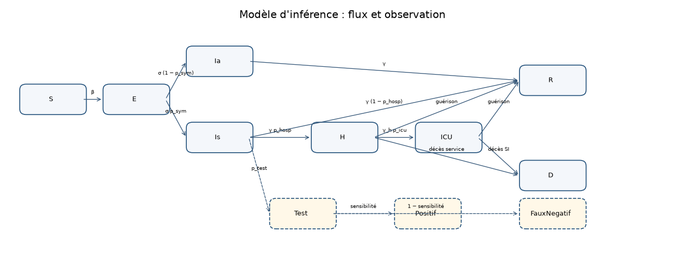
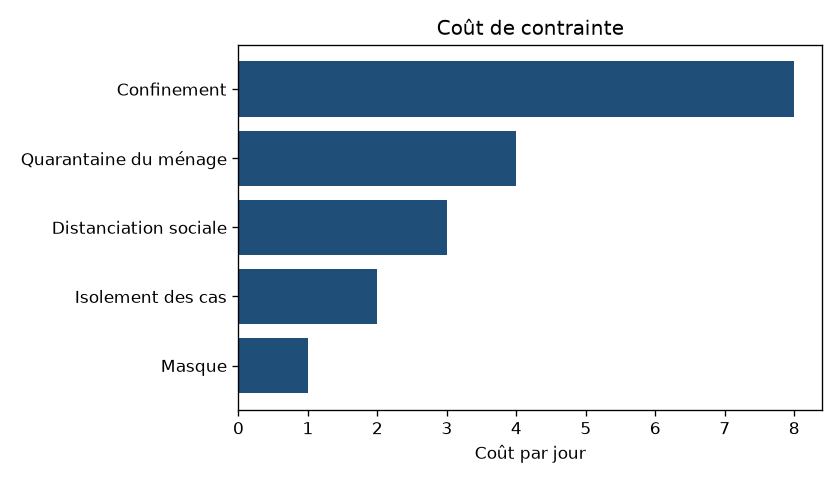
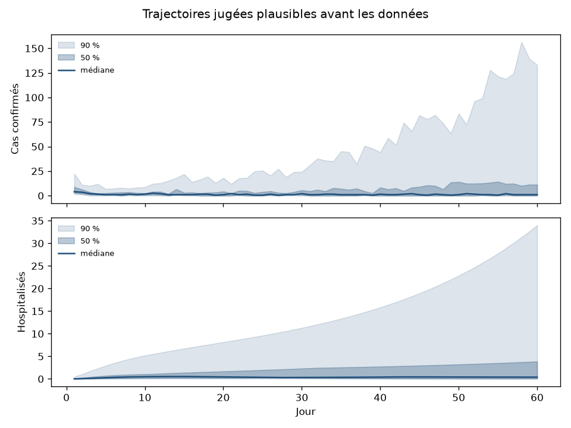
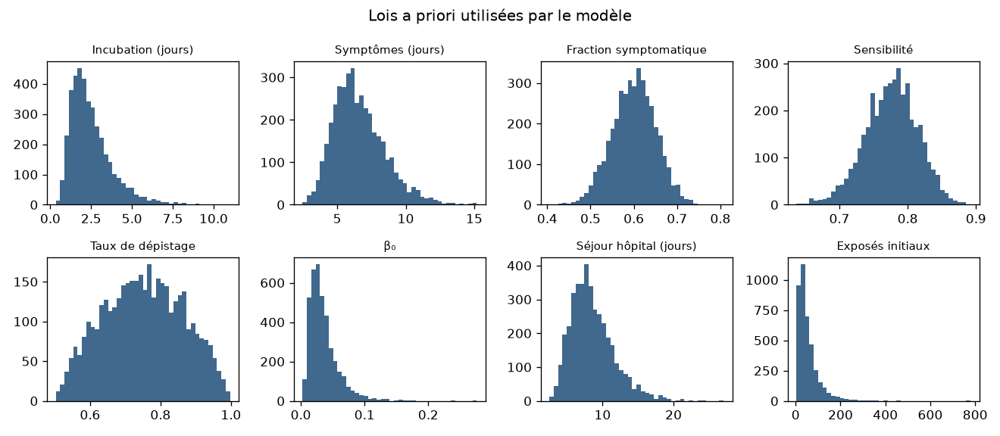
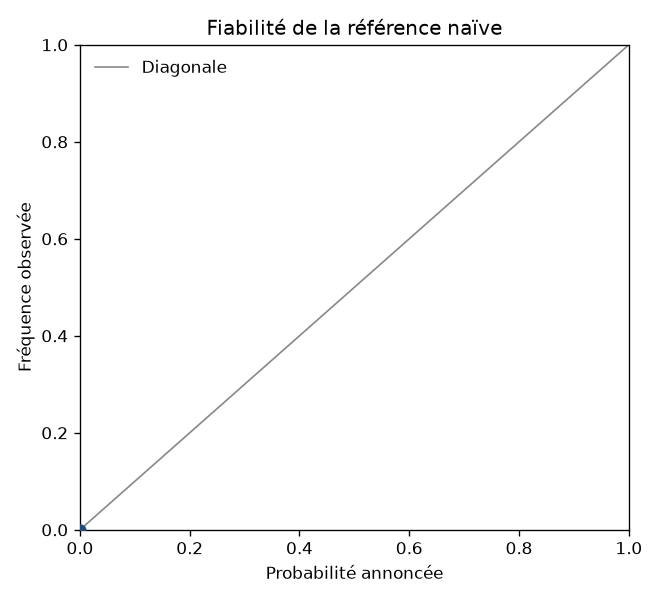

# Une ville, une loi, une décision

PROJ0016, refonte bayésienne. 1 000 000 habitants, du 2 octobre 2020 au 31 janvier 2021.

---

# Ce que l'on voit

Cas confirmés, tests, hospitalisés, soins intensifs, décès. Pas les infectés.

Rester sous 1 500 hospitalisés et 300 soins intensifs.

---

# Pourquoi une loi

P(saturation) n'existe que si plusieurs futurs restent possibles.

Seuil de décision : 5 %.

---

# Le modèle

SEIRH par âge, variante A, \(\beta(t)\) en marche aléatoire hebdomadaire.

L'observation est en pointillés : test, sensibilité, faux négatif.

---

# Les priors

Incubation 1–5 jours. Symptômes 4–10 jours.

Fraction symptomatique 50 %–70 %. Sensibilité 70 %–85 %.

---

# L'inférence

nuts, 4 chaînes, 500 pas d'échauffement, 500 tirages.

R̂ sous 1,01, ESS au moins 400.

---

# Ce que les données changent

Un paramètre est identifié si son intervalle rétrécit sous 0,50 fois le prior.

Aucun fichier .nc dans le dossier d'inférence. Les comparaisons entre prior et posterior, le R̂ et l'ESS apparaissent après epidemic fit.

---

# Projections

12 trajectoires a priori de 60 jours, avec bruit d'observation.

Sur les 14 derniers jours de cas confirmés du fichier du cours, la pente de log(1 + cas) vaut 0,07 par jour, soit un temps de doublement d'environ 9,84 jours.

---

# Coût et risque

On garde le paquet le moins coûteux avec P(saturation) ≤ 5 %.

Sans posterior, le graphe est l'échelle de coût, pas une probabilité inventée.

---

# Recommandation

Délai 3 jours, durée minimale 14 jours, respect 90 %.

Masque, isolement, quarantaine, distanciation, confinement. La quarantaine ne se combine pas avec l'isolement.

---

# Calibration

Intervalles à 90 % : 31 % de réussite sur 80 prévisions. Intervalles à 50 % : 24 %.

Les intervalles sont trop sûrs d'eux : la valeur réalisée tombe dedans moins souvent que le niveau annoncé.

---

# Limites

Le modèle ne voit pas la ville cachée. Il est plus simple qu'elle, exprès.

Niveaux de stochasticité 0 à 3. Variante d'inférence A.

