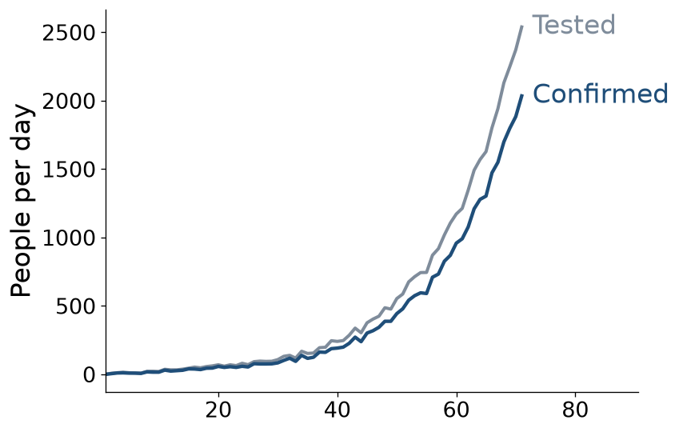
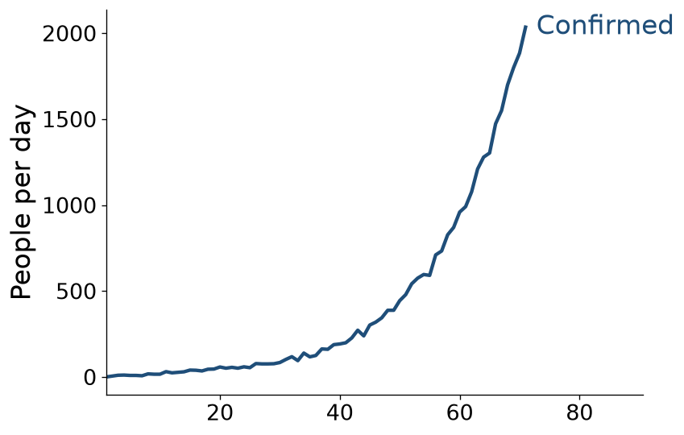
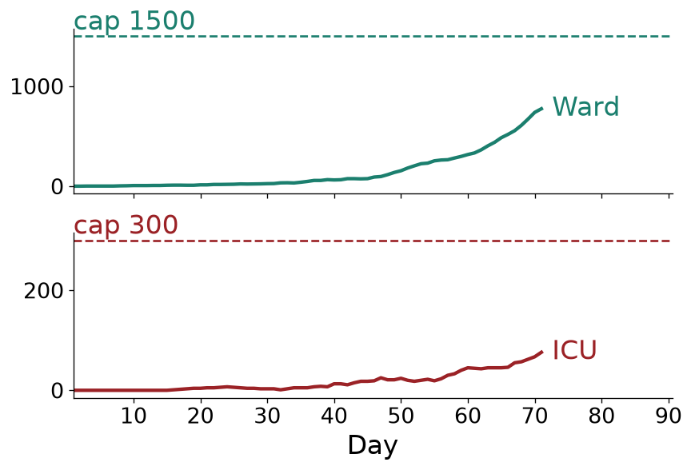
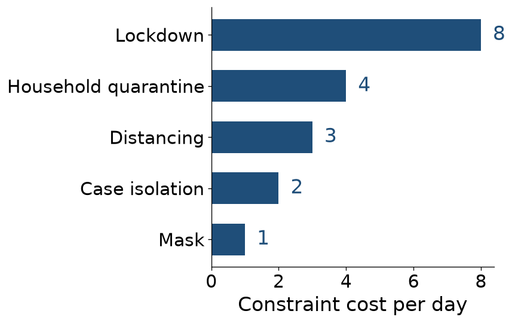
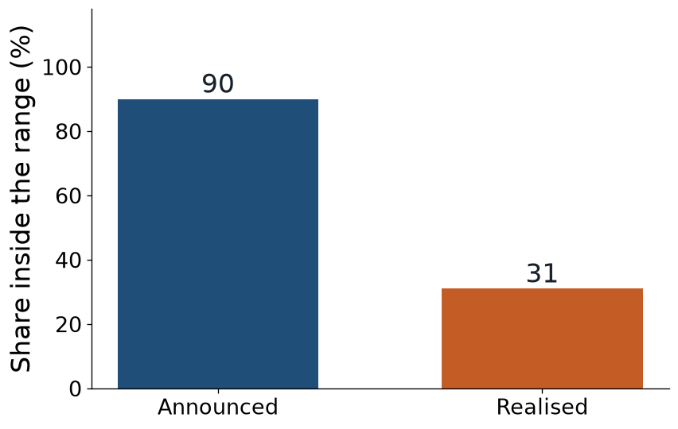

<!-- _class: lead -->

# Deciding under uncertainty: steering a simulated epidemic with Bayesian forecasts

dimiphoton

24 November 2026

App: `app/accueil.py`

<!--
Open on the decision, not on the method.
The app is the thing they can click.
One million people, one weekly choice, an incomplete picture.
-->

---

# A city of 1 million, incomplete data, and a decision every week

What is known on decision day?

- Published series are tested cases
- A negative test can miss an infection
- The week ends before the outcome is known

<!--
Point at the gap between the two curves.
Tested is not the same count as confirmed, and neither is the infected population.
The decision is taken on this picture, every week.
-->

---

# Confirmed cases are not infections, and that hidden share is not estimated yet

Where is the infection curve?

Only confirmed cases are drawn. The hidden share is not estimated.

<!--
Do not invent a second curve.
Say plainly that the model has not produced that share yet.
The chart is the count a manager would actually be handed.
-->

---

# Hospital saturation risk is not scored until the model has been fitted

How close did the beds get to the cap?

Ward peaked at 774, cap 1500. ICU peaked at 76, cap 300.

<!--
Read the two peaks against the two caps.
If the cap line is absent, the peak is far below it and the scale stays readable.
No saturation probability is attached to this chart.
-->

---

# No measure is recommended yet, because saturation risk is still missing

Which measure is selected?

None. The risk is missing, so cost is not traded against it.

<!--
The bars are the daily social cost, cheapest at the top.
Do not pick one. The rule needs a risk, and that risk is not scored.
-->

---

# Only 31% of 80 later outcomes fell inside the 90% simple comparison ranges

What share of later outcomes fell inside the announced range?

Realised 31%. Announced 90%.

<!--
These ranges are a simple comparison, not a fitted model.
80 later outcomes were scored.
The gap between the two bars is the whole point.
-->

---

# What this project shows about how I work

- The model never reads the hidden city
- Ranges are scored on later outcomes
- No measure is picked while the risk is missing

JAX, NumPyro, ArviZ, Streamlit

<!--
Close on three habits: separation of the hidden city, scored ranges, silence when the risk is missing.
Name the stack once, then stop.
-->
