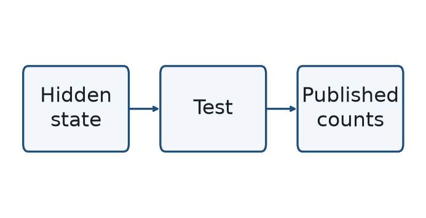
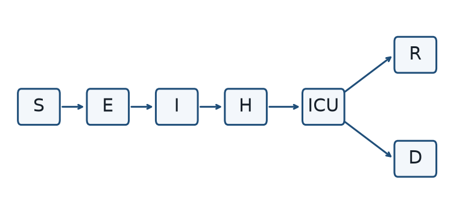
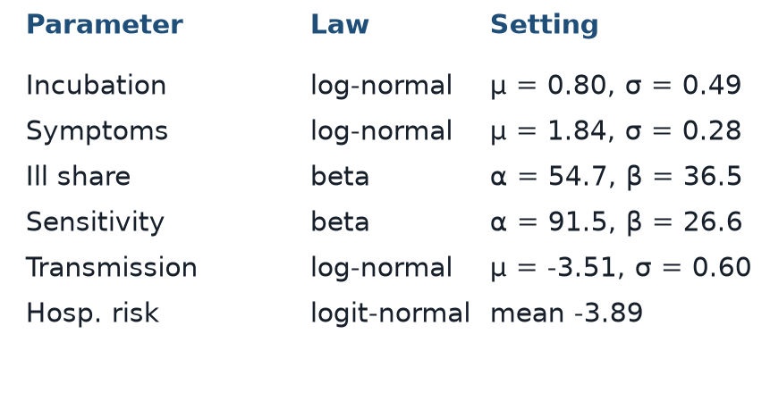
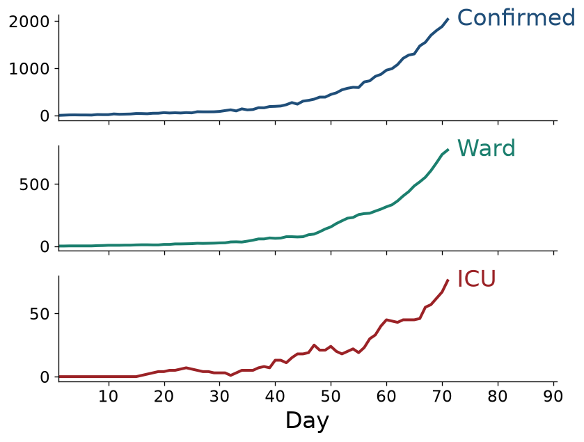
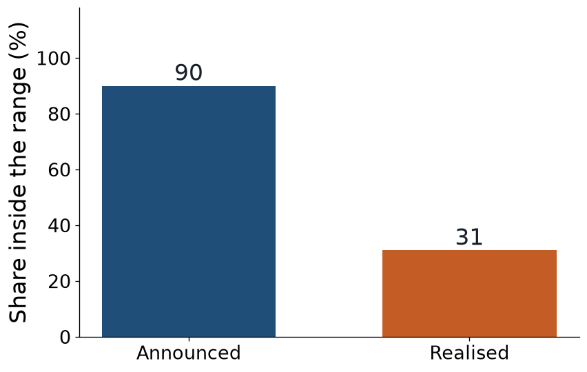
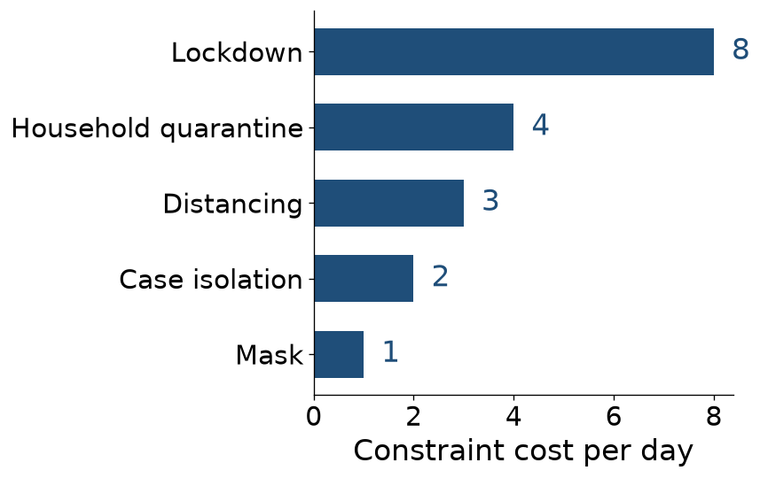
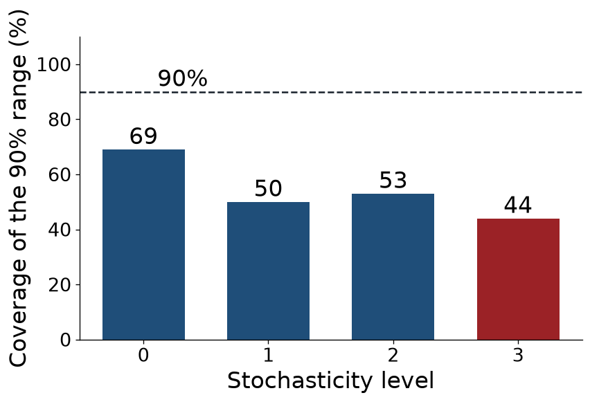

<!-- _class: lead -->

# Bayesian SEIRH inference and decision support for a simulated epidemic

https://github.com/dimiphoton/bigdataSIR

<!--
Give the repository and the question: hidden epidemic, partial counts, a decision.
Do not preview every diagnostic.
-->

---

# The analyst sees only noisy, partial observations of a hidden process

What reaches the analyst?

Published counts. The hidden state stays off this side of the arrow.

$$
\mathbb{E}[Y^{+}] = \mathrm{sens}\, p_{\mathrm{test}}\, C_{\mathrm{sym}} + A
$$

<!--
A is an admission that was not already confirmed.
Flu positives drop out while specificity stays at 1.
Walk the three boxes once, then the expectation.
-->

---

# The generative model: age-structured SEIRH with an explicit testing layer

What does one forward step update?

Exit rates are the reciprocals of the two spells.

$$
\sigma = 1/d_{E}, \qquad \gamma = 1/d_{I}
$$

<!--
S to E to I to hospital to ICU is the inference model, not the richer city.
Presymptomatic infection lives only in the simulator.
Name sigma and gamma, then move on.
-->

---

# Priors encode the brief, not guesses

Which beliefs are fixed before any data?

Six priors. A bound from the brief, or a marked hypothesis.

<!--
Incubation, symptomatic days, the symptomatic fraction and sensitivity come from the brief.
Transmission and hospitalisation do not. Say which is which.
The rest of the catalogue is in the long note, not on this slide.
-->

---

# NUTS has not been run, so convergence is not measured yet

Did the chains converge?

No NUTS file is saved, so R-hat and the ESS are not measured.

$$
\hat{R} < 1.01, \quad \mathrm{ESS} \ge 400, \quad D \le 0
$$

<!--
Read the three gates as the definition of a usable run.
Do not show a trace that was never computed.
The next step is to store a NUTS fit and come back to this slide.
-->

---

# How many parameters the data pin down is not measured yet

How is a parameter judged pinned down?

The width ratio is not computed. No posterior interval is on file.

$$
w_{\mathrm{post}} / w_{\mathrm{prior}} < 0.50
$$

<!--
Below 0.50 the prior has narrowed enough to call the parameter pinned.
Between that and the partial gate it is only partly pinned.
We do not yet know which side any parameter falls on.
-->

---

# Whether testing rate and hospitalisation rate are confounded is still unknown

Can the testing rate be separated from the hospitalisation rate?

No joint posterior is saved, so the trade-off is not measured.

$$
Y^{+} \propto p_{\mathrm{test}} \times \mathrm{incidence}, \quad H \propto p_{\mathrm{hosp}} \times \mathrm{incidence}
$$

<!--
Both rates multiply the same hidden incidence.
Several pairs can print the same confirmed cases and the same ward counts.
That is why the title refuses to claim they are confounded or that they are not.
-->

---

# Posterior predictive checks are not run, because no posterior is saved

Which series would a posterior check have to cover?

Confirmed, ward and ICU are drawn. Deaths are the fourth. No draw is scored.

<!--
Three series is the maximum on one figure, so deaths stay in the sentence.
The curves are the published record, not a predictive fan.
A check starts only once posterior draws exist.
-->

---

# Model skill against baselines is not scored, and course baseline ranges cover only 31%

By how much do model forecasts beat a simple comparison?

They are not scored. The comparison covers 31% of course outcomes.

<!--
The bars are the simple comparison on the course file, 80 forecasts.
Do not quote a CRPS gain. There is no model score to subtract.
-->

---

# Whether adaptive triggers beat fixed policies is unknown without scored scenarios

Do adaptive triggers beat a fixed measure?

No scenario risk is scored. The costs are known. The risks are not.

$$
a^{\star} = \arg\min \mathrm{cost}(a) \ \text{s.t.}\ P(\mathrm{sat}) \le 5\%
$$

<!--
Alpha is 5 percent.
The chart is only the cost coordinate.
A frontier needs the missing probability, so none is drawn.
-->

---

# Baseline 90% ranges miss at every stochasticity level, down to 44% at level 3

Up to which stochasticity level do the 90% ranges hold?

None. The low point is 44% at level 3.

<!--
These are baseline ranges on simulated public series, one level at a time.
The dashed line is the nominal 90%.
Every bar misses it. Level 3 is the lowest.
-->

---

# Three concrete limits remain, and each one has a next step

- No posterior file yet. Next: run NUTS and keep the draws.
- Baseline ranges cover too little. Next: score the model on the same grid.
- The frontier has costs only. Next: attach a saturation probability.

<!--
One limit, one next step, then stop.
Do not add a fourth.
The three gaps are the fit, the score, and the risk.
-->
