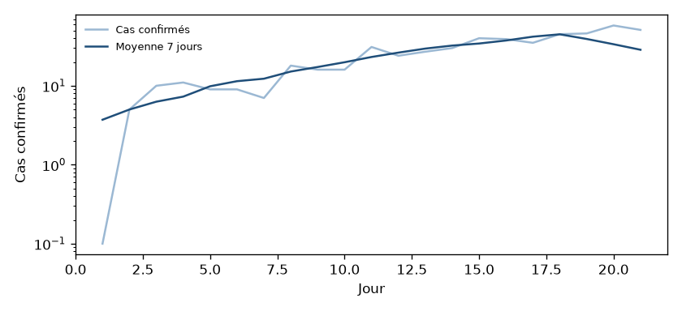
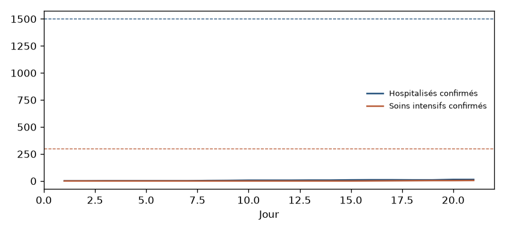

## Situation en bref

Au jour 21 (22 octobre 2020), les cas confirmés des 7 derniers jours sont 314, en hausse par rapport à la semaine précédente. Le taux de positivité confirmé sur 7 jours est 79,5 %, stable par rapport à la semaine précédente. Les hospitalisés confirmés sont 14, en hausse par rapport à la semaine précédente, et les soins intensifs confirmés sont 5, en hausse par rapport à la semaine précédente. Les nouveaux décès confirmés de la semaine sont 0. La probabilité estimée, selon la référence naïve de persistance, que les hospitalisés confirmés dépassent 1 500 dans les 28 jours est 0 % (exceptionnellement improbable). Ce n'est pas encore la probabilité du modèle bayésien.

## Indicateurs

| Indicateur | Valeur | Semaine précédente |
|---|---:|---:|
| Cas confirmés, 7 jours | 314 | 162 |
| Positivité confirmée, 7 jours | 79,5 % | 78,3 % |
| Hospitalisés confirmés | 14,0 | 8,00 |
| Soins intensifs confirmés | 5,00 | 0,00 |
| Nouveaux décès confirmés | 0,00 | 0,00 |

## Hôpital face à la capacité

Plafonds : 1 500 hospitalisés, 300 soins intensifs.

## Projections

À 14 jours, la médiane estimée de la référence naïve est 54 cas confirmés et 14 hospitalisés. À 28 jours, la médiane estimée de la référence naïve est 52 cas confirmés et 15 hospitalisés.

La probabilité estimée par la référence naïve, que les hospitalisés dépassent le plafond dans l'horizon prévu, est 0 % (exceptionnellement improbable).

## Recommandation

Palier 1. Mesures autorisées : Masque, Isolement des cas. La recommandation estimée, soit le coût le plus bas sous le seuil de saturation, sera jointe quand une loi a posteriori sera enregistrée.

Palier 1. Mesures autorisées : Masque, Isolement des cas.
