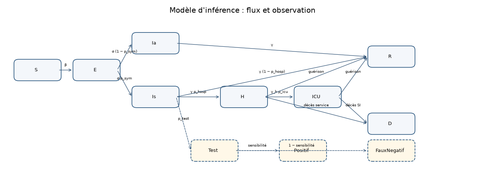
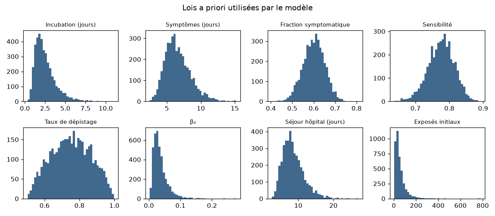
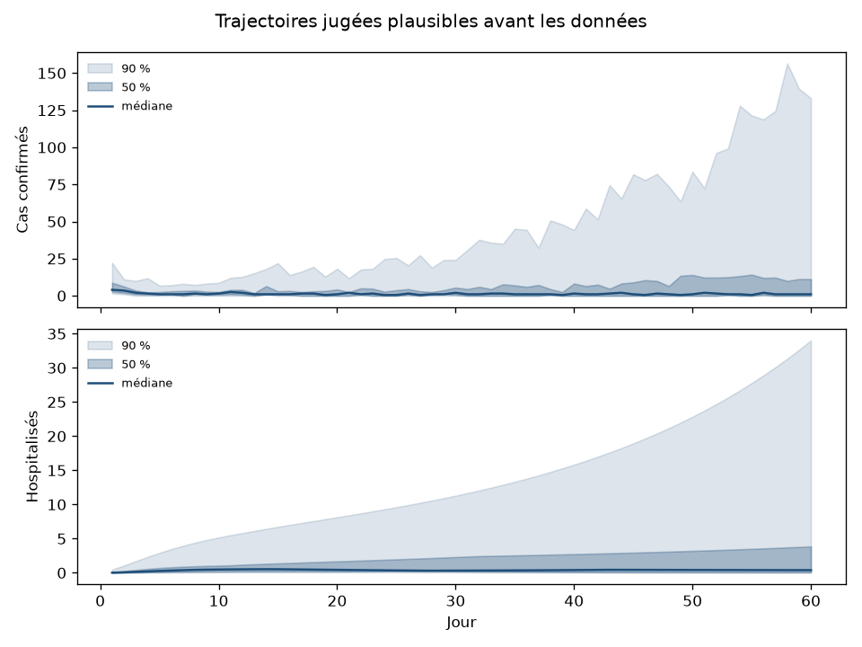
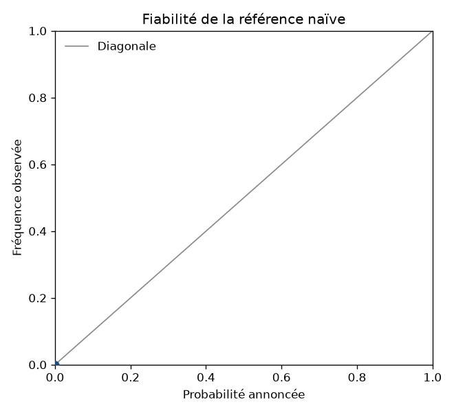
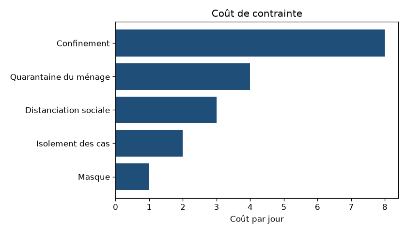

# Rapport

Ville de 1 000 000 habitants, du 2 octobre 2020 au 31 janvier 2021. Document généré, graine 0. Le développement long est dans `docs/framework-bayesien.md`.

## 1. Contexte

Le cours publiait chaque jour des séries partielles. La décision consiste à rester sous 1 500 hospitalisés et 300 soins intensifs jusqu'au 31 janvier 2021, avec l'intervention la moins contraignante. L'approche bayésienne produit P(saturation), pas une trajectoire unique.

## 2. Données

Colonnes publiées : cas confirmés, tests, hospitalisés, hospitalisations cumulées, soins intensifs, décès cumulés. La sensibilité annoncée va de 70 % à 85 %, la spécificité vaut 100 %, et au moins 50 % des symptomatiques sont testés. Sur les 14 derniers jours de cas confirmés du fichier du cours, la pente de log(1 + cas) vaut 0,07 par jour, soit un temps de doublement d'environ 9,84 jours.

## 3. Modèle

Variante A, 2 groupes d'âge, \(\beta(t)\) en marche aléatoire hebdomadaire. L'incubation va de 1 à 5 jours, la période symptomatique de 4 à 10 jours, la fraction symptomatique de 50 % à 70 %.

| Paramètre | Loi | Paramètres | Intervalle à 95 % | Source | Justification |
|---|---|---|---|---|---|
| Durée d'incubation | Log-normale | μ = 0.80, σ = 0.49 | 2,24 (0,86 à 5,83 j) | consigne | L'intervalle central à 90 % vaut 1 à 5 jours. |
| Durée symptomatique | Log-normale | μ = 1.84, σ = 0.28 | 6,32 (3,66 à 10,9 j) | consigne | L'intervalle central à 90 % vaut 4 à 10 jours, avant l'hôpital. |
| Fraction symptomatique | Beta | α = 54.7, β = 36.5 | 0,60 (0,50 à 0,70) | consigne | Moyenne 0,60, pour couvrir 50 à 70 % des infectés. |
| Sensibilité des tests | Beta | α = 91.5, β = 26.6 | 0,78 (0,70 à 0,85) | consigne | Moyenne 0,775, pour couvrir 70 à 85 %. |
| Taux de dépistage | Beta décalée | 0,50 + 0,50 × Beta(2, 2) | 0,75 (0,55 à 0,95) | consigne | Plancher de 50 % (consigne). La forme au-dessus est peu informative. |
| Spécificité des tests | Fixée, ou Beta | 1, ou Beta(199, 1) si on l'estime | 1 (fixée) | consigne | Les consignes donnent 100 %. L'estimation est une analyse de sensibilité. |
| Transmission β₀ | Log-normale | μ = -3.51, σ = 0.60 | 0,03 (0,01 à 0,10) | hypothèse | Par contact pondéré. La médiane 0,03 vise un R de l'ordre de 1. |
| Volatilité hebdomadaire de β | Demi-normale | échelle 0.15 | 0,10 (0,00 à 0,34) | hypothèse | La marche aléatoire hebdomadaire reste modérée. |
| Saut de β entre deux dates | Demi-normale | échelle 0.8 | 0,54 (0,02 à 1,81) | hypothèse | En mode constant par morceaux, un changement peut être fort. |
| Contagiosité des asymptomatiques | Beta | α = 2, β = 2 | 0,50 (0,09 à 0,91) | hypothèse | Relative aux symptomatiques, moyenne 0,5, sans borne dans les consignes. |
| Durée d'hospitalisation | Log-normale | médiane 8 j, σ = 0.35 | 8,00 (4,03 à 15,9 j) | hypothèse | Les consignes ne donnent pas la durée de séjour. |
| Durée en soins intensifs | Log-normale | médiane 10 j, σ = 0.35 | 10,0 (5,04 à 19,9 j) | hypothèse | Les consignes ne donnent pas la durée de séjour. |
| Probabilité d'hospitalisation | Logit-normale hiérarchique | moyenne logit -3.89, échelle 1.0 | 0,02 (0,00 à 0,13) | hypothèse | Autour de 2 % chez les plus jeunes. Pas de chiffre dans les consignes. |
| Pente d'âge de la gravité | Log-normale | μ = 0.41, σ = 0.35 | 1,50 (0,76 à 2,98) | consigne du projet | Les plus âgés ont un prior plus élevé. La pente est positive. |
| Passage en soins intensifs | Logit-normale hiérarchique | moyenne logit -1.73 | 0,15 (0,02 à 0,55) | hypothèse | Parmi les sorties d'hôpital, autour de 15 %, même pente d'âge. |
| Décès en service | Logit-normale hiérarchique | moyenne logit -3.89 | 0,02 (0,00 à 0,13) | hypothèse | Parmi les sorties d'hôpital qui ne vont pas en soins intensifs. |
| Décès en soins intensifs | Logit-normale hiérarchique | moyenne logit -1.10 | 0,25 (0,04 à 0,71) | hypothèse | Parmi les sorties de soins intensifs. |
| Exposés initiaux | Log-normale | μ = 3.69, σ = 0.8 | 40,0 (8,34 à 192) | hypothèse | Quelques dizaines de personnes au jour 0, réparties comme la population. |
| Part initiale déjà infectieuse | Beta | α = 2, β = 5 | 0,26 (0,04 à 0,65) | hypothèse | Moins d'infectieux que d'exposés au départ. |
| Fond de syndromes grippaux | Log-normale | μ = 5.70, σ = 0.6 | 300 (92,6 à 972) | hypothèse | Tests de personnes non infectées. Les consignes ne donnent pas le niveau. |
| Surdispersion des observations | Log-normale | μ = 3.40, σ = 0.7 | 30,0 (7,61 à 118) | hypothèse | Variante B seulement. Variante A : concentration fixée dans le YAML. |
| Bruit de la dynamique latente | Demi-normale | échelle 1.0 | 0,68 (0,03 à 2,24) | hypothèse | Variante C : bruit normal, en écarts-types binomiaux. |

## 4. Inférence et diagnostics

nuts, 4 chaînes, 500 pas d'échauffement, 500 tirages. Seuils : R̂ sous 1,01, ESS au moins 400, au plus 0 divergence. Aucun fichier .nc dans le dossier d'inférence. Les comparaisons entre prior et posterior, le R̂ et l'ESS apparaissent après epidemic fit. R̂ lu : non calculé. ESS lu : non calculé. Divergences lues : non calculé.

## 5. Validation

Intervalles à 90 % : 31 % de réussite sur 80 prévisions. Intervalles à 50 % : 24 %. Les intervalles sont trop sûrs d'eux : la valeur réalisée tombe dedans moins souvent que le niveau annoncé. CRPS persistance 144, CRPS croissance 135, Brier 0,00, sur 80 prévisions naïves. Aucun score de posterior n'est enregistré. Les couvertures de cette section sont celles des références naïves, persistance et croissance exponentielle, pas encore celles du modèle.

| Série | Horizon (jours) | Prévisions | Couverture 50 % | Couverture 90 % | CRPS persistance | CRPS exponentielle |
|---|---:|---:|---:|---:|---:|---:|
| nouveaux décès | 7 | 8 | 88 % | 100 % | 0,43 | 0,51 |
| nouveaux décès | 14 | 7 | 86 % | 86 % | 0,67 | 0,68 |
| nouveaux décès | 28 | 5 | 60 % | 60 % | 1,26 | 1,16 |
| soins intensifs | 7 | 8 | 25 % | 38 % | 6,73 | 9,78 |
| soins intensifs | 14 | 7 | 14 % | 29 % | 12,4 | 29,0 |
| soins intensifs | 28 | 5 | 0 % | 0 % | 26,0 | 172 |
| hospitalisés | 7 | 8 | 0 % | 0 % | 83,7 | 46,6 |
| hospitalisés | 14 | 7 | 0 % | 0 % | 151 | 115 |
| hospitalisés | 28 | 5 | 0 % | 0 % | 285 | 168 |
| cas confirmés | 7 | 8 | 0 % | 38 % | 200 | 26,8 |
| cas confirmés | 14 | 7 | 0 % | 0 % | 394 | 113 |
| cas confirmés | 28 | 5 | 0 % | 0 % | 748 | 1 320 |

| Trajectoire | Prévisions | Couverture 90 % | CRPS persistance | CRPS exponentielle | Brier |
|---|---:|---:|---:|---:|---:|
| niveau 0 | 32 | 69 % | 11,9 | 3,70 | 0,00 |
| niveau 1 | 32 | 50 % | 16,8 | 6,58 | 0,00 |
| niveau 2 | 32 | 53 % | 25,6 | 10,2 | 0,00 |
| niveau 3 | 32 | 44 % | 21,9 | 33,1 | 0,00 |

La courbe d'apprentissage est prévue aux jours 7, 14, 21, 28, 35, 42, 49, 56, 63, 70. Un rapport de largeurs sous 0,50 est lu comme bien identifié, sous 0,85 comme partiellement identifié.

## 6. Projections

12 tirages de 60 jours, paramètres dans les priors, dynamique du scan, bruit gamma-Poisson de concentration 100. Les horizons de bulletin sont 14, 28 jours.

## 7. Probabilités de saturation

La saturation est le dépassement de 1 500 hospitalisés ou de 300 soins intensifs. L'événement scoré ici est le dépassement hospitalier dans les 28 jours, pour la référence naïve. Son score de Brier est 0,00. Sur cette série, le plafond d'hospitalisés n'est pas franchi dans les fenêtres scorées, et la persistance ne l'annonce presque pas. Le Brier est donc bas sans mesurer un événement qui arrive vraiment.

## 8. Recommandation

Règle : coût cumulé minimal sous P(saturation) ≤ 5 %. Autres seuils : 1 %, 5 %, 10 %, 20 %. Délai 3 jours, durée minimale 14 jours, respect 90 %. Isolement : 7, 10, 14 jours. Distanciation : 50, 60, 70 ans. Le palier 2 peut s'ouvrir plus tôt si la probabilité que les hospitalisés dépassent 750 dépasse 20 %. Le palier 3, si P(saturation) dépasse 20 %.

| Mesure | Coût par jour |
|---|---:|
| Masque | 1,00 |
| Isolement des cas | 2,00 |
| Distanciation sociale | 3,00 |
| Quarantaine du ménage | 4,00 |
| Confinement | 8,00 |

## 9. Calibration en fin de partie

Intervalles à 90 % : 31 % de réussite sur 80 prévisions. Intervalles à 50 % : 24 %. Les intervalles sont trop sûrs d'eux : la valeur réalisée tombe dedans moins souvent que le niveau annoncé. La ventilation par niveau de stochasticité est le second tableau de la section 5. Les mêmes indicateurs seront recalculés sur les tirages du modèle dès qu'un posterior sera scoré.

## 10. Limites

Le modèle n'a pas de stade présymptomatique. Il ne lit pas les paramètres secrets de la ville. Les détails sont dans `docs/hypotheses.md`, recopié dans la documentation longue au moment de `make docs`.

## 11. Reproductibilité

`make install`, puis `make all`. La graine de rendu est 0. Les commandes `epidemic docs`, `epidemic report`, `epidemic bulletin --day 21` et `epidemic slides` relisent les YAML. Aucun chiffre de ce rapport n'est saisi dans le gabarit.
